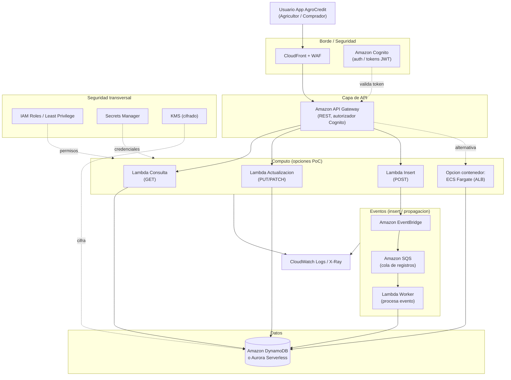

# Arquitectura — AgroCredit en AWS

## Vigente (2026-10-05): lo que despliega `cloud/terraform`

Sin el monitoreo del panel de resiliencia (decisión 60). Para ver un `.mmd`: <https://mermaid.live> o una extensión de Mermaid.

| Archivo | Qué muestra | Para quién |
|---|---|---|
| [`arquitectura-demo-cloud-v2.mmd`](arquitectura-demo-cloud-v2.mmd) | Vista lógica por capas: entrada, cómputo, identidad, datos, escrituras asíncronas, fotos, operación | Explicar la solución en 1 minuto |
| [`arquitectura-aws-v2.mmd`](arquitectura-aws-v2.mmd) | Vista de despliegue en AWS (cuenta, región, VPC, zonas, subredes, servicios) con el **por qué** de cada decisión (Dn = decisión del handoff) | Base para redibujar con íconos oficiales de AWS |
| [`flujo-negocio.mmd`](flujo-negocio.mmd) | Recorrido del agricultor y del comprador, con las decisiones del sistema | Negocio y demo |
| [`flujo-tecnico.mmd`](flujo-tecnico.mmd) | Secuencia técnica: login, padrón, foto con Rekognition y escritura asíncrona de campaña u oferta | Desarrollo y evaluación técnica |

Con íconos oficiales de AWS (decisión 63, generados por código con la librería `diagrams` 0.25.1):

| Archivo | Qué muestra |
|---|---|
| [`agrocredit-arquitectura-aws.png`](agrocredit-arquitectura-aws.png) / [`.svg`](agrocredit-arquitectura-aws.svg) | Despliegue en AWS: VPC, 2 zonas, ALB, Fargate, Cognito, DynamoDB, SQS, Lambda, S3, Rekognition y operación |
| [`agrocredit-flujo-tecnico.png`](agrocredit-flujo-tecnico.png) / [`.svg`](agrocredit-flujo-tecnico.svg) | Flujo técnico numerado: 1 registro e inicio de sesión, 2 campaña con foto, 3 oferta |

Fuente: `diagramas.py` + `diagramas.Dockerfile` (los SVG llevan los íconos incrustados). Para regenerarlos, desde `arquitectura/` y con Docker abierto:

```bash
docker build -t agro-diagramas:0.25.1 -f diagramas.Dockerfile .
docker run --rm -v "$PWD":/trabajo agro-diagramas:0.25.1 python diagramas.py
#windows powershell: docker run --rm -v "${PWD}:/trabajo" agro-diagramas:0.25.1 python diagramas.py
```

Estimación de costos a 1000 usuarios sobre esta arquitectura: [`../docs/costos/costos.md`](../docs/costos/costos.md).

La v1 de estos diagramas quedó en el proyecto anterior (`Agrocredit`).

Documentación de las APIs: [`../docs/api/agrocredit-api.html`](../docs/api/agrocredit-api.html) (se regenera con `python tareas.py documentar` desde `cloud/`).

### Propuesta inicial vs. implementado, y por qué cambió

| Propuesta inicial (2026-10-01) | Implementado | Por qué |
|---|---|---|
| CloudFront + WAF | ALB HTTP 80 directo | Costo y simplicidad del lab; sin dominio propio no hay certificado. Limitación documentada (sin HTTPS ni WAF). |
| API Gateway + Lambda por operación | ALB + ECS Fargate (2 contenedores en 2 zonas) | Se definió desde el inicio usar 2 contenedores con balanceador; permite demostrar que si un contenedor cae el otro sigue atendiendo. |
| EventBridge -> SQS -> worker | SQS -> Lambda worker | EventBridge no aporta para un solo consumidor; SQS da reintentos y DLQ. |
| DynamoDB o Aurora Serverless | DynamoDB on-demand | Pago por uso y sin servidor encendido: cabe en USD 50. Aurora cobra por capacidad mínima. |
| IAM de menor privilegio, Secrets Manager, KMS propia | Un solo LabRole, sin secretos (Cognito guarda las claves), cifrado gestionado por AWS | Restricciones del Learner Lab. Los roles objetivo se documentan en `docs/seguridad.md` (pendiente). |
| CloudWatch + X-Ray | CloudWatch Logs con retención de 1 día | Costo; X-Ray no es necesario para la demo. |

---

## Propuesta inicial (histórica, 2026-10-01)

Diagrama simple e **ilustrativo** de la solución para una Prueba de Concepto (PoC).
Cubre tres operaciones sobre registros — **consulta**, **actualización** e **insert** —
y muestra dos caminos de cómputo (Lambda directo a BD, o insert mediante eventos),
con una opción de contenedor y la capa de seguridad, todo en la nube de AWS.

> Todo es referencial para una PoC. Los nombres de servicios son orientativos y
> se pueden ajustar según costo, equipo y volumen.

## Diagrama

El diagrama de esta propuesta quedó en el proyecto anterior (`Agrocredit/arquitectura/arquitectura-poc.mmd`); se incluye abajo como referencia.
Para verlo: pégalo en <https://mermaid.live>, o usa una extensión de Mermaid en el editor.



## Flujo

1. **Usuario** (agricultor o comprador) entra por **CloudFront + WAF** (borde y protección básica).
2. **Amazon Cognito** autentica y emite tokens JWT; **API Gateway** los valida con un autorizador.
3. **API Gateway** enruta cada operación a su cómputo:
   - **Consulta (GET)** → `Lambda Consulta` → lee de la **BD**.
   - **Actualización (PUT/PATCH)** → `Lambda Actualizacion` → escribe en la **BD**.
   - **Insert (POST)** → dos opciones (ver abajo).
4. **Observabilidad**: todo el cómputo emite métricas/trazas a **CloudWatch Logs / X-Ray**.

## Dos caminos para el INSERT (decisión de la PoC)

- **A) Lambda directo a BD** (más simple): `Lambda Insert` escribe directo en la BD.
  Menos piezas, menor latencia, ideal para empezar la PoC.
- **B) Mediante eventos** (desacoplado): `Lambda Insert` publica a **EventBridge** →
  **SQS** (amortigua picos y da reintentos) → `Lambda Worker` persiste en la BD.
  Útil si el insert dispara efectos secundarios (notificaciones, matching comprador-campaña)
  o si se espera carga variable.

Para la PoC se recomienda **empezar con A** y evolucionar a **B** cuando aparezcan
integraciones o necesidad de desacople.

## Cómputo: Lambda vs contenedor

- **Lambda (serverless)**: recomendado para la PoC — sin servidores que administrar,
  escala a cero, pago por uso. Encaja con el patrón por operación (consulta/actualización/insert).
- **ECS Fargate (contenedor)** detrás de un **ALB**: alternativa si el equipo ya tiene
  imágenes/stack en contenedores, procesos largos, o dependencias que no encajan en Lambda.
  Se muestra como camino opcional desde API Gateway.

## Datos

- **Amazon DynamoDB**: NoSQL serverless, simple y barato para una PoC con acceso por clave.
- **Aurora Serverless (PostgreSQL/MySQL)**: si se requiere SQL relacional y consultas complejas.

Elegir una según el modelo de datos; ambas aplican el cifrado con KMS.

## Seguridad (ilustrativa)

- **WAF**: filtra tráfico malicioso en el borde.
- **Cognito**: identidad y autorización (JWT) antes de llegar al cómputo.
- **IAM con menor privilegio**: cada Lambda/servicio con un rol acotado a lo que necesita.
- **Secrets Manager**: credenciales y secretos fuera del código.
- **KMS**: cifrado en reposo de la BD (y de secretos/colas según se requiera).
- **TLS** en tránsito de extremo a extremo.

## Alcance de la PoC

- Demostrar las tres operaciones (consulta, actualización, insert) de punta a punta.
- Mostrar el patrón por eventos como evolución del insert.
- Dejar visible la capa de seguridad mínima en la nube.
- No es diseño de producción: faltan multi-AZ/DR, cuotas finas, pruebas de carga,
  pipeline CI/CD y hardening completo, que se abordarían después de validar la PoC.
