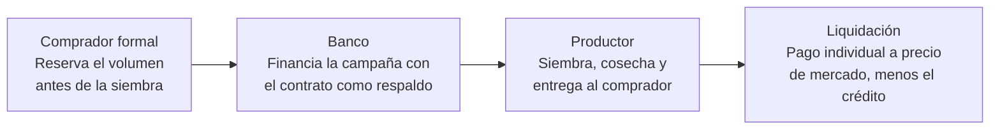
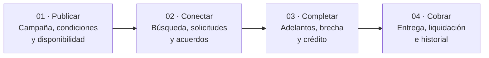
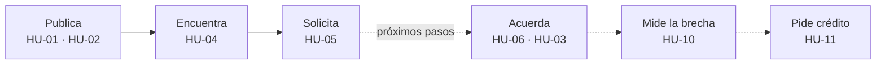
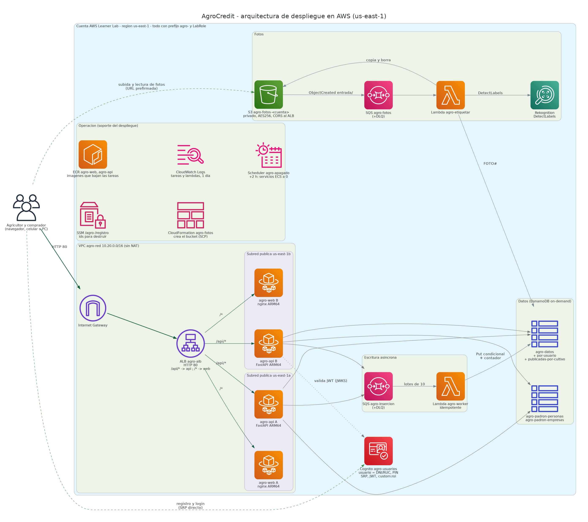
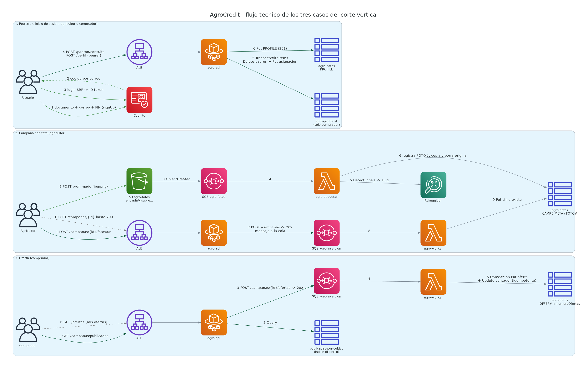

# Proyecto Parcial — AgroCredit

> **Maestría en Ciencia de Datos e Inteligencia Artificial (CDIA V5)** · UTEC Posgrado
> **Curso:** Cloud Computing · **Docente:** Oscar Mejía
> **Entrega:** martes 06-oct-2026, 23:59 · **Exposición virtual:** miércoles 07-oct-2026, 19:00
> **Integrantes:** Cristina · Aris · Noelia · Axel · Jesús 


--

# Parte A — Análisis (QUÉ)

## 1. Producto 100% digital propuesto

**AgroCredit — crédito de campaña con venta asegurada.** El banco financia la siembra y liquida a cada productor al precio de mercado del día de entrega (dos precios fijados).



| Tipo de clientes | Funcionalidades | Propuesta de valor |
|---|---|---|
| Pequeños productores, individuales o asociados | Contrato de compra previo a la siembra | **Productor:** venta segura, crédito formal e historial |
| Compradores formales: agroindustria, exportadores, molinos | Crédito de campaña respaldado por el contrato | **Comprador:** abastecimiento sin financiar a nadie |
| | Liquidación individual automática a la entrega | **Banco:** repago directo desde la venta |

## 2. Benchmark

Cuatro competidores en Perú: una fintech, una agtech, una caja municipal y el banco agropecuario del Estado. Fichas completas con fuentes y diagramas: [`benchmark-agrocredit.md`](benchmark-agrocredit.md).

| Competidor | Tipo | Tipos de clientes | Funcionalidades | Propuesta de valor | Fuente |
|---|---|---|---|---|---|
| **Agroinvesting** | Fintech | Agricultores de 1 a 20 ha (papa, arroz, camote); trabajadores rurales no bancarizados; medianas empresas agrícolas | Crédito de capital de trabajo e insumos; financiamiento de riego, invernaderos y maquinaria; marketplace Agrosmart | Crédito sin historial bancario; montos pequeños adaptados a la campaña; más de 11 mil agricultores financiados | Gestión (entrevista al CEO) |
| **Agros** | Agtech (Piura) | Agricultores familiares; organizaciones de productores; aliados: fintechs, microfinancieras y entidades públicas | Identidad digital accesible por llamada; app de campo offline y panel web; seguros con imágenes satelitales; teleasesoría | Historial digital para acceder a crédito; mercados y servicios en un solo lugar; 10 a 20 mil productores conectados | Descubre.vc; GFAR/INCLUDAS (2022); Agraria.pe (2023) |
| **Caja Piura (App Rural)** | Caja municipal | Familias agricultoras rurales de 20 a 74 años (27% mujeres) en San Martín, Amazonas, La Libertad, Cajamarca, Áncash y Lima | App para asesores que opera sin conexión; recolección digital de datos; aprobación inmediata en campo | Crédito sin ir a la agencia; inclusión en zonas alejadas; 392 créditos por S/ 1.81 millones en un año | DPL News / Perú21 |
| **Agrobanco** | Banca estatal | Pequeños productores agrícolas y pecuarios, individuales o asociados (55% accede a su primer crédito) | Crédito de campaña y pecuario; banca por internet para ver deuda; en desarrollo billetera digital y autoaprobación; más de 120 puntos de atención | La tasa más baja del mercado (TEA 3.5% AgroPerú); cuotas al fin de campaña; 127 mil créditos por S/ 1,443 millones en 2025 | Agraria.pe (abr 2026); Andina (sep 2026); DPL News |

### 2.1 Cuadro comparativo

**Ningún competidor nacional asegura la compra antes de financiar.**

| Criterio | Agroinvesting | Agros | Caja Piura | Agrobanco | **AgroCredit** |
|---|---|---|---|---|---|
| Tipo de clientes | Productores de 1 a 20 ha y trabajadores rurales | Agricultores familiares y sus organizaciones | Familias rurales | Pequeños productores y asociaciones | **Pequeños productores y compradores formales** |
| Canal digital | Plataforma fintech | App offline, panel web, llamada | App offline del asesor | Consulta web; billetera en camino | **Digital para solicitud y liquidación** |
| Compra asegurada antes de sembrar | No | No (conecta compradores) | No | No | **Sí** |
| Financia la campaña | Sí, montos pequeños | No, deriva a financieras | Sí | Sí, TEA 3.5% | **Sí, respaldada por el contrato** |
| Pago al productor por su cosecha | No aplica | No aplica | No aplica | No aplica | **Individual, a precio de mercado (dos precios fijados)** |
| Propuesta de valor | Inclusión con montos pequeños | Datos e identidad para acceder a servicios | Cercanía y aprobación en campo | La tasa más baja | **Venta segura + crédito + pago directo** |

### 2.2 Conclusión: el contrato de compra como garantía

1. **Lo digital está en la evaluación, no en la venta.** Caja Piura y Agros digitalizan la originación; nadie conecta el crédito con el comprador.
2. **La tasa la marca el Estado.** Agrobanco presta a 3.5%: hay que competir por certeza de venta, no por precio.
3. **Espacio libre en Perú.** Ningún competidor nacional integra compra asegurada, crédito y pago individual.

## 3. Tipos de clientes y usuarios

Tres usuarios alrededor de una misma campaña:

| # | Actor | Rol | Qué hace |
|---|---|---|---|
| 01 | **Productor agrícola** | Usuario principal | Publica su campaña, define condiciones, elige solicitudes y consulta su liquidez |
| 02 | **Comprador formal** | Cliente | Busca producción futura y solicita volumen bajo una modalidad de pago |
| 03 | **Banco / plataforma** | Operador | Canaliza pagos, registra liquidaciones y permite solicitar crédito por la brecha |

**Alcance:** precondición común, usuario autenticado. **Fuera de alcance:** pérdida de cosecha, comprobantes tributarios y decisión crediticia automática.

## 4. Funcionalidades

### 4.1 Mapa del backlog V1

16 historias de usuario en 4 épicas: de la campaña futura a la liquidación registrada. **4 forman el MVP** implementado en AWS; las demás son próximos pasos. Cada historia sigue la plantilla COMO / QUIERO / PARA, con criterios de aceptación en Gherkin (BDD).



| Épica | Historia | Usuario | Alcance |
|---|---|---|---|
| 01 Publicar | HU-01 Registrar campaña | Productor | **MVP** |
| 01 Publicar | HU-02 Definir precios | Productor | **MVP** |
| 01 Publicar | HU-03 Ver volumen disponible | Productor | Próximos pasos |
| 02 Conectar | HU-04 Buscar campañas | Comprador | **MVP** |
| 02 Conectar | HU-05 Enviar solicitud | Comprador | **MVP** |
| 02 Conectar | HU-06 Aceptar o rechazar | Productor | **MVP**  |
| 02 Conectar | HU-07 Consultar acuerdos | Productor | Próximos pasos |
| 03 Completar | HU-09 Pagar adelanto | Comprador | Próximos pasos |
| 03 Completar | HU-10 Ver liquidez y brecha | Productor | Próximos pasos |
| 03 Completar | HU-11 Solicitar crédito | Productor | Próximos pasos |
| 04 Cobrar | HU-12 Registrar entrega | Productor | Próximos pasos |
| 04 Cobrar | HU-13 Confirmar y pagar | Comprador | Próximos pasos |
| 04 Cobrar | HU-14 Ver liquidación | Productor | Próximos pasos |
| 04 Cobrar | HU-15 Ver historial | Productor | Próximos pasos |
| Soporte | HU-16 Asistente en mi idioma | Productor | Próximos pasos |

### 4.2 Historias de usuario y criterios de aceptación

#### Épica 1 · Publicar la campaña

**HU-01 · Registrar campaña** · Productor · MVP
**Como** productor agrícola, **quiero** registrar mi campaña, **para** hacer visible mi oferta futura a compradores formales.

```gherkin
# language: es
Escenario: Publicar una campaña
  Dado que el productor inició sesión en la plataforma
  Cuando selecciona "Nueva campaña"
  Y ingresa cultivo, ubicación, volumen (kg), fecha de cosecha futura y capital requerido (S/)
  Y presiona "Publicar"
  Entonces la campaña queda "Publicada" con todo su volumen
  Y aparece en la búsqueda de compradores compatibles
```

> Próximos pasos: indicar si la campaña es "antes de sembrar" o "en curso".

**HU-02 · Definir precios** · Productor · MVP
**Como** productor agrícola, **quiero** definir un precio con adelanto y otro contraentrega, **para** negociar conservando el control de mi venta.

```gherkin
# language: es
Escenario: Fijar los dos precios
  Dado que el productor está registrando su campaña
  Cuando el sistema muestra el precio de referencia de mercado
  Y ingresa el precio con adelanto y el precio contraentrega (S/ por kg)
  Entonces ambos precios quedan guardados y visibles para compradores

Escenario: Falta un precio
  Dado que deja uno de los dos precios vacío
  Cuando intenta publicar
  Entonces el sistema no publica y pide completar ambos precios
```

**HU-03 · Ver volumen disponible** · Productor · Próximos pasos
**Como** productor agrícola, **quiero** ver el volumen total, comprometido y disponible, **para** saber cuánto puedo seguir ofreciendo.

```gherkin
# language: es
Escenario: Volumen comprometido y disponible
  Dado una campaña de 10 t con un acuerdo aceptado de 4 t
  Cuando el productor abre el detalle de su campaña
  Entonces ve total 10 t, comprometido 4 t y disponible 6 t

Escenario: Sin volumen disponible
  Dado que el volumen disponible llega a 0 t
  Cuando un comprador busca campañas
  Entonces la campaña ya no aparece en los resultados
```

#### Épica 2 · Conectar con compradores

**HU-04 · Buscar campañas** · Comprador · MVP
**Como** comprador formal, **quiero** buscar campañas futuras por cultivo, zona y fecha, **para** asegurar mi abastecimiento.

```gherkin
# language: es
Escenario: Búsqueda con filtros
  Dado que el comprador inició sesión en la plataforma
  Cuando ingresa a "Buscar campañas"
  Y filtra por cultivo y departamento
  Entonces ve las campañas publicadas que cumplen los filtros
  Y cada una muestra volumen, fecha de cosecha y los dos precios

Escenario: Sin resultados
  Cuando ninguna campaña cumple los filtros
  Entonces se muestra que no hay campañas publicadas de ese cultivo en ese departamento
```

> Próximos pasos: filtros por fecha de cosecha y volumen mínimo; ocultar campañas sin volumen disponible (depende de HU-03).

**HU-05 · Enviar solicitud** · Comprador · MVP
**Como** comprador formal, **quiero** enviar una solicitud de compra a una campaña, **para** reservar producción antes de la cosecha.

```gherkin
# language: es
Escenario: Solicitud enviada
  Dado que el comprador ve una campaña con volumen disponible
  Cuando presiona "Solicitar compra" e ingresa el volumen
  Y elige modalidad "Pago ahora" (adelanto) o "Pago contraentrega", el precio y la fecha de entrega
  Y presiona "Enviar"
  Entonces la solicitud queda "Pendiente"
  Y el productor la ve en "Ofertas recibidas" de su campaña

Escenario: Solicitud inválida
  Cuando el volumen supera el de la campaña o la fecha de entrega ya pasó
  Entonces el sistema bloquea el envío y muestra el motivo
```

> Próximos pasos: monto del adelanto (regla 03: hasta el 100% del valor) y notificación al productor.

**HU-06 · Aceptar o rechazar** · Productor · Próximos pasos
**Como** productor agrícola, **quiero** aceptar o rechazar solicitudes de compra, **para** elegir las condiciones que más me convienen.

```gherkin
# language: es
Escenario: Aceptar una solicitud
  Dado que el productor tiene una solicitud pendiente de 4 t y 10 t disponibles
  Cuando revisa comprador, volumen, modalidad y adelanto
  Y presiona "Aceptar"
  Entonces se crea un acuerdo en estado "Aceptado"
  Y el volumen disponible baja a 6 t y el comprador es notificado

Escenario: Rechazar una solicitud
  Cuando presiona "Rechazar"
  Entonces la solicitud pasa a "Rechazada" y el volumen no cambia
```

**HU-07 · Consultar acuerdos** · Productor · Próximos pasos
**Como** productor agrícola, **quiero** consultar mis acuerdos de venta, **para** conocer el estado de cada compromiso.

```gherkin
# language: es
Escenario: Mis acuerdos
  Dado que el productor tiene acuerdos registrados
  Cuando ingresa a "Mis acuerdos"
  Entonces ve por acuerdo: comprador, volumen, precio, modalidad y estado
  Y solo ve los acuerdos de sus propias campañas
```

#### Épica 3 · Completar el capital

**HU-09 · Pagar adelanto** · Comprador · Próximos pasos
**Como** comprador formal, **quiero** pagar el adelanto a través de la plataforma, **para** asegurar el volumen que reservé.

```gherkin
# language: es
Escenario: Adelanto pagado
  Dado que el comprador tiene un acuerdo aceptado con modalidad adelanto
  Cuando presiona "Pagar adelanto" y confirma el pago
  Entonces el monto se abona en la cuenta del productor
  Y el acuerdo muestra "Adelanto pagado"
  Y el productor recibe una notificación
```

**HU-10 · Ver liquidez y brecha** · Productor · Próximos pasos
**Como** productor agrícola, **quiero** ver mis adelantos y mi brecha de financiamiento, **para** saber si necesito crédito adicional.

```gherkin
# language: es
Escenario: Brecha de financiamiento
  Dado un capital requerido de S/ 12 000 y adelantos acordados por S/ 8 000
  Cuando el productor abre "Mi liquidez"
  Entonces ve el adelanto de cada acuerdo y el total S/ 8 000
  Y ve brecha = S/ 4 000 (capital requerido − adelantos)
  Y la brecha se recalcula con cada nuevo acuerdo

Escenario: Capital cubierto
  Dado que los adelantos cubren todo el capital requerido
  Entonces ve "Capital cubierto: no necesitas crédito"
```

**HU-11 · Solicitar crédito** · Productor · Próximos pasos
**Como** productor agrícola, **quiero** solicitar un crédito al banco solo por mi brecha, **para** completar el capital de mi campaña.

```gherkin
# language: es
Escenario: Crédito por la brecha
  Dado que el productor tiene al menos 1 acuerdo aceptado y una brecha de S/ 4 000
  Cuando presiona "Solicitar crédito"
  Y ingresa un monto menor o igual a S/ 4 000 y confirma
  Entonces la solicitud queda registrada "En evaluación"

Escenario: Sin brecha o sin acuerdos
  Dado que no tiene acuerdos aceptados o su brecha es S/ 0
  Entonces el botón "Solicitar crédito" aparece deshabilitado
```

#### Épica 4 · Cobrar y soporte

**HU-12 · Registrar entrega** · Productor · Próximos pasos
**Como** productor agrícola, **quiero** registrar la entrega de un acuerdo, **para** iniciar la liquidación de mi venta.

```gherkin
# language: es
Escenario: Entrega registrada
  Dado que el productor tiene un acuerdo en estado "Aceptado"
  Cuando selecciona el acuerdo y presiona "Registrar entrega"
  Y ingresa el volumen entregado y la fecha
  Entonces el acuerdo pasa a "Entregado, por confirmar"
  Y el comprador es notificado para confirmar la recepción
```

**HU-13 · Confirmar y pagar** · Comprador · Próximos pasos
**Como** comprador formal, **quiero** confirmar la recepción y pagar el saldo, **para** cerrar el acuerdo con trazabilidad.

```gherkin
# language: es
Escenario: Acuerdo liquidado
  Dado que un acuerdo está "Entregado, por confirmar"
  Cuando el comprador confirma el volumen recibido
  Y paga el saldo (valor de la venta − adelanto)
  Entonces AgroCredit descuenta la cuota del crédito, si existe
  Y abona el neto al productor y el acuerdo pasa a "Liquidado"
```

**HU-14 · Ver liquidación** · Productor · Próximos pasos
**Como** productor agrícola, **quiero** consultar la liquidación de cada acuerdo, **para** saber cuánto dinero recibiré.

```gherkin
# language: es
Escenario: Detalle de la liquidación
  Dado que el comprador confirmó la recepción de un acuerdo
  Cuando el productor abre la liquidación del acuerdo
  Entonces ve valor de venta, adelanto recibido y cuota descontada
  Y ve el monto neto a recibir
  Y ve el estado del pago: "Pendiente" o "Abonado"
```

**HU-15 · Ver historial** · Productor · Próximos pasos
**Como** productor agrícola, **quiero** consultar mi historial de campañas, **para** demostrar mi cumplimiento como productor.

```gherkin
# language: es
Escenario: Historial de campañas cerradas
  Dado que el productor tiene acuerdos liquidados
  Cuando ingresa a "Mi historial"
  Entonces ve cada campaña cerrada con volumen vendido, monto y fecha de cierre
  Y no puede editar ni borrar registros del historial
```

**HU-16 · Asistente en mi idioma** · Productor · Próximos pasos
**Como** productor agrícola, **quiero** recibir orientación de un asistente en mi idioma, **para** usar la plataforma con confianza.

```gherkin
# language: es
Escenario: Asistente en quechua
  Dado que el productor eligió quechua como idioma
  Cuando pregunta al asistente cómo registrar su campaña
  Entonces recibe la explicación paso a paso en quechua
  Y si el asistente propone un dato, solo se guarda cuando el productor confirma
```

### 4.3 Reglas de negocio

| # | Regla |
|---|---|
| 01 | El productor publica dos precios (con adelanto y contraentrega) con referencia de mercado. |
| 02 | Puede aceptar uno o varios compradores hasta agotar el volumen disponible. |
| 03 | El adelanto puede cubrir hasta el 100% del valor de lo comprado, nunca más. |
| 04 | El crédito se solicita solo si hay brecha y al menos 1 acuerdo aceptado. |
| 05 | La liquidación se realiza por acuerdo y descuenta la cuota cuando corresponda. |

## 5. Propuesta de valor

### 5.1 Por tipo de cliente

| | Productor | Comprador formal | Banco |
|---|---|---|---|
| **Dolor** | Financia a ciegas y vende al precio de quien le prestó | Abastecimiento incierto y disperso entre muchos productores | El productor no llega a pedir crédito y no hay información para evaluarlo |
| **Alivio** | Demanda visible antes de cosechar y varias ofertas | Ve oferta futura por cultivo, volumen, fecha y zona | Entra por la venta, no por el crédito |
| **Ganancia** | Fija su precio, elige modalidad y construye historial | Asegura volumen y compra más barato si adelanta | Clientes, pagos, depósitos, colocación e información |

### 5.2 Comparación con el benchmark

**Solo AgroCredit asegura la venta, financia y liquida a la vez.**

| Competidor | Tipo | Compra asegurada antes de sembrar | Financia la campaña | Paga al productor su cosecha | Propuesta de valor |
|---|---|---|---|---|---|
| Agroinvesting | Fintech | ○ No; marketplace sin compra asegurada | ● Sí, montos pequeños | ○ No aplica | Inclusión con montos pequeños |
| Agros | Agtech | ○ No; conecta compradores | ○ No, deriva a financieras | ○ No aplica | Datos e identidad para acceder a servicios |
| Caja Piura | Caja municipal | ○ No | ● Sí, aprobación en campo | ○ No aplica | Cercanía y aprobación en campo |
| Agrobanco | Banca estatal | ○ No | ● Sí, TEA 3.5% | ○ No aplica | La tasa más baja |
| **AgroCredit** | Banco + plataforma | ● Sí, acuerdos antes de cosechar | ● Sí, solo la brecha | ● Sí, por acuerdo | **Venta segura + crédito + pago directo** |

Los competidores digitalizan la evaluación o bajan la tasa. AgroCredit compite por otra cosa: certeza de venta antes de sembrar, crédito solo para la brecha y pago directo al productor.

## 6. MVP: producto mínimo viable

**4 historias de negocio, implementadas en 14 historias técnicas (HI), que prueban la primera mitad del ciclo: hay demanda antes de sembrar.**



| En el MVP (implementado en AWS) | Por qué |
|---|---|
| HU-01 Registrar campaña, HU-02 Definir precios | Sin campaña no hay nada que comprar: es la oferta futura del productor |
| HU-04 Buscar campañas, HU-05 Enviar solicitud | Valida la hipótesis central: el comprador formal reserva producción antes de la cosecha |
| Historias implementadas HI-01 a HI-14 (§13.1): cuenta e inicio de sesión, perfiles con padrón, fotos reconocidas con IA, actualizar campaña, mis campañas, mis ofertas, ofertas recibidas, seguridad por rol, resiliencia | Son la base para operar con dos usuarios reales en la nube: identidad, confianza en el producto ofrecido y disponibilidad |

Recorre el flujo de punta a punta con los dos usuarios (productor y comprador) y está implementado completo en la Parte C. Acordar, medir la brecha y pedir crédito dependen de que primero exista demanda; por eso son el siguiente incremento.


---

# Parte B — Diseño del MVP (CÓMO)

## 7. Diseño del FrontEnd (prototipo)

Prototipo web **responsive**, pensado primero para celular, en HTML, CSS y JavaScript. Tiene un sistema de diseño propio (tokens de color, tipografía Poppins) y la marca AgroCredit: [`BRAND-GUIDE.md`](BRAND-GUIDE.md). Código: [`../web/`](../web/).

| Flujo | Pantallas |
|---|---|
| Común | Portada, elección de rol, crear cuenta (documento y correo), PIN, código del correo, inicio de sesión |
| Alta del productor | Datos personales, cuenta AgroCredit (simulado), cultivos del catálogo, ubicación, perfil listo |
| Alta del comprador | Empresa (padrón por RUC), representante (padrón por DNI), preferencias, cuenta de cargo y modalidad de pago, verificación |
| Productor | Registrar campaña con fotos, condiciones con los dos precios y la referencia de mercado, revisar y publicar, campaña publicada, inicio con mis campañas, ofertas recibidas |
| Comprador | Búsqueda por cultivo y departamento, detalle del lote con fotos, enviar oferta, mis ofertas |
| Operación | Panel "Estado del servicio": contenedores, zonas y tráfico por API |

Las pantallas que no forman parte de lo implementado se muestran como pasos simulados y no guardan datos inventados.

## 8. Diseño del BackEnd (microservicios)

La API es una aplicación FastAPI (Python 3.12) con cuatro dominios funcionales. Corre en contenedores ECS Fargate y se apoya en dos funciones Lambda (serverless). Catálogo completo: [`api/agrocredit-api.html`](api/agrocredit-api.html).

| Microservicio | Métodos | Base de datos | Cómputo |
|---|---|---|---|
| **Plataforma** | `GET /salud` | — (estado de la tarea) | ECS Fargate |
| **Identidad y perfil** | `GET /config`, `GET /perfil`, `POST /perfil` | DynamoDB `agro-datos` (ítems `USER#…/PROFILE`) + Amazon Cognito | ECS Fargate |
| **Campañas y fotos** | `POST /campanas`, `GET /campanas`, `GET /campanas/publicadas`, `GET /campanas/{id}`, `PATCH /campanas/{id}`, `POST /campanas/{id}/fotos/url`, `GET /campanas/{id}/fotos` | DynamoDB `agro-datos` (ítems `CAMP#…/META` y `FOTO#…`) + S3 `agro-fotos` | ECS Fargate + Lambda `agro-worker` + Lambda `agro-etiquetar` (Rekognition) |
| **Ofertas** (solicitudes de compra) | `POST /campanas/{id}/ofertas`, `GET /campanas/{id}/ofertas`, `GET /ofertas` | DynamoDB `agro-datos` (ítems `CAMP#…/OFFER#…`) | ECS Fargate + Lambda `agro-worker` |
| **Padrón y catálogos** | `POST /padron/consulta`, `GET /catalogo/cultivos`, `GET /cuentas-demo` | DynamoDB `agro-padron-empresas` y `agro-padron-personas` (tablas propias) + catálogo en `agro-datos` | ECS Fargate |

**Escrituras asíncronas:** crear una campaña o una oferta responde **202**. El mensaje pasa por SQS (con cola de mensajes fallidos) y la Lambda `agro-worker` lo escribe de forma idempotente. Así no se pierde nada ante fallos, la API responde rápido y se absorben los picos.

### 8.1 Diseño de la base de datos (NoSQL)

Detalle: [`base-datos/agrocredit-base-datos.md`](base-datos/agrocredit-base-datos.md). Incluye por qué DynamoDB, el modelo entidad-relación equivalente, el modelo real, los patrones de acceso, qué tabla toca cada API y consultas para la demo.

| Tabla | Clave | Índices | Qué guarda |
|---|---|---|---|
| `agro-datos` | PK + SK | `por-usuario`; `publicadas-por-cultivo` (disperso) | Perfiles, campañas, fotos, ofertas, catálogo, cuentas de prueba, asignaciones del padrón |
| `agro-padron-empresas` | `id` | — | 10 empresas ficticias (simula SUNAT), sin RUC |
| `agro-padron-personas` | `id` | — | 10 personas ficticias (simula RENIEC), sin DNI |


**Por qué DynamoDB y no PostgreSQL:** se paga por uso, sin servidor encendido, así que cabe en los USD 50 del laboratorio. Además, los patrones de acceso son conocidos y por clave. Aurora o RDS cobran una capacidad mínima aunque no haya tráfico.

## 9. Diagrama de arquitectura de solución en AWS



Flujo técnico numerado: registro e inicio de sesión, campaña con foto, oferta.



| Capa | Servicio | Decisión |
|---|---|---|
| Entrada | Application Load Balancer (HTTP 80) | `/api/*` va al servicio api y `/*` al servicio web |
| Cómputo | ECS Fargate ARM64: 2 contenedores web (nginx) + 2 api (FastAPI) en 2 zonas | Activo-activo: si cae un contenedor, el otro sigue atendiendo |
| Identidad | Amazon Cognito | Usuario = DNI o RUC, PIN de 6 dígitos, rol inmutable |
| Datos | DynamoDB on-demand (3 tablas) | Pago por uso |
| Eventos | SQS + cola de fallidos → Lambda | Escritura idempotente y reintentos |
| Fotos e IA | S3 privado → SQS → Lambda → Amazon Rekognition | Etiquetado automático del cultivo |
| Red | VPC propia, 2 subredes públicas, grupos de seguridad | Las tareas solo aceptan tráfico del ALB; sin NAT, por costo |
| Operación | EventBridge Scheduler, SSM, CloudWatch Logs | Apagado automático, registro de recursos, logs de 1 día |
| Infraestructura como código | Terraform 1.16.5 + `tareas.py` | Despliegue y destrucción con un comando, en cualquier cuenta |

Diagramas Mermaid y comparación entre la propuesta inicial y lo implementado: [`../arquitectura/README.md`](../arquitectura/README.md).

## 10. Región de AWS: **us-east-1 (Norte de Virginia)**

| Criterio | Sustento |
|---|---|
| Restricción del entorno | La cuenta AWS Academy Learner Lab solo permite us-east-1 |
| Disponibilidad de servicios | Todos los servicios del diseño están en us-east-1, incluido Amazon Rekognition (DetectLabels), la pieza de IA. Verificado: el MVP corre ahí |
| Costo | us-east-1 está entre las regiones de menor precio de lista; la estimación (§11) usa sus precios |
| Latencia desde Perú | Mayor que con una región sudamericana. Aceptable para una app de formularios y fotos (supuesto, no medido) |
| Datos personales (Ley 29733) | El MVP usa solo datos ficticios. En producción, alojar datos fuera del Perú es un flujo transfronterizo: exige garantizar un nivel de protección adecuado y declararlo |

**En producción** se evaluaría **sa-east-1 (São Paulo)** por cercanía, comparando su precio frente a us-east-1 y confirmando que ofrece Rekognition y los demás servicios del diseño.

## 11. Costos mensuales

Región us-east-1, servicio 24x7, 1,000 usuarios activos al mes (70% productores, 30% compradores).

| Escenario | Qué incluye | USD por mes | Fuente |
|---|---|---|---|
| **Uso mínimo** | Solo la arquitectura desplegada hoy: 4 tareas Fargate, 1 ALB, 6 IPv4 públicas, DynamoDB on-demand, colas estándar, Lambdas sin capacidad reservada, logs de 1 día | **93.97** (70.68 con la capa gratuita permanente) | [`costos/costos.md`](costos/costos.md) y [`costos/calculadora.csv`](costos/calculadora.csv) |
| **Uso medio** | La misma arquitectura con capacidad adicional contratada para crecer y operar (detalle abajo) | **376.05** (+ 180.01 de pago inicial; 4,692.61 a 12 meses) | [calculator.aws](https://calculator.aws/#/estimate?id=187644643d677306dc2806bc06a070bb05a8e75a) · PDF [`aws-calculate.pdf`](aws-calculate.pdf) |

**Qué agrega el escenario medio sobre el mínimo:**

| Servicio | Mínimo | Medio | Qué se agrega |
|---|---|---|---|
| Amazon VPC | 21.90 | 219.00 | Demanda|
| DynamoDB | 0.15 | 26.39 + 180.00 inicial | Manyor demanda |
| Elastic Load Balancing | 16.60 | 36.87 | Demanda |
| Amazon Cognito | 15.00 | 29.25 | Otra configuración del plan (mismos 1,000 MAU) |
| Data Transfer | 7.49 | 20.48 | Mayor demanda |
| CloudWatch | 0.39 | 7.17 | Monitoreo sintético (canaries), métricas y Database Insights |
| SQS | 0.53 | 2.90 | Colas FIFO y equitativas además de las estándar |
| Lambda | 0.01 | 0.85 | Simultaneidad aprovisionada |
| Rekognition, S3, ECR | 3.06 | 4.30 | Más fotos y almacenamiento |
| AWS Fargate | 28.84 | 28.84 | Igual: 4 tareas ARM64 |

**Lectura:**
- **El costo lo mueve la configuración, no el número de usuarios.** Con la arquitectura desplegada, pasar de un uso moderado a uno intensivo (el doble de sesiones y el triple de ofertas) sube el costo de USD 94 a USD 137 (`costos.md`, escenario alto). 
- **Alrededor del 72% del escenario mínimo es fijo** (Fargate, ALB e IPv4 públicas) y existe por la resiliencia (2 contenedores en 2 zonas), no por la carga.
- **Costos ocultos identificados:** IPv4 públicas, fotos sin miniaturas, web sin compresión ni caché y sondeo de SQS.

---

# Parte C — Implementación del MVP en AWS

## 12. Catálogo de APIs

- **Catálogo navegable** en español: [`api/agrocredit-api.html`](api/agrocredit-api.html). Agrupa por microservicio e indica rol de acceso, parámetros, cuerpo, respuestas, ejemplos y `curl`.
- **Contrato OpenAPI 3.1** (fuente única, versión 1.6.0): [`../cloud/api/openapi.yaml`](../cloud/api/openapi.yaml). Todo cambio empieza en el contrato, y una prueba automática compara la API con el contrato.
- **Swagger en vivo** del despliegue: `http://<dns-del-alb>/api/docs`.

| API | Microservicio | Acceso | Tipo | Tabla o servicio |
|---|---|---|---|---|
| `GET /salud` | Plataforma | Público | Lectura | Estado de la tarea ECS |
| `GET /config` | Identidad y perfil | Público | Lectura | IDs de Cognito |
| `GET /perfil` · `POST /perfil` | Identidad y perfil | Ambos roles | Lectura · escritura directa | `agro-datos` |
| `GET /catalogo/cultivos` | Padrón y catálogos | Ambos roles | Lectura | `agro-datos` |
| `POST /padron/consulta` | Padrón y catálogos | Comprador | Transacción | `agro-padron-*` + `agro-datos` |
| `GET /cuentas-demo` | Padrón y catálogos | Comprador | Lectura | `agro-datos` |
| `POST /campanas` | Campañas y fotos | Productor | Escritura asíncrona (202) | SQS → Lambda → `agro-datos` |
| `GET /campanas` | Campañas y fotos | Productor | Lectura | `agro-datos` (índice `por-usuario`) |
| `GET /campanas/publicadas` | Campañas y fotos | Comprador | Lectura | `agro-datos` (índice `publicadas-por-cultivo`) |
| `GET /campanas/{id}` | Campañas y fotos | Ambos roles | Lectura | `agro-datos` |
| `PATCH /campanas/{id}` | Campañas y fotos | Productor dueño | Actualización directa | `agro-datos` |
| `POST /campanas/{id}/fotos/url` | Campañas y fotos | Productor | URL prefirmada | S3 → SQS → Lambda → Rekognition → `agro-datos` |
| `GET /campanas/{id}/fotos` | Campañas y fotos | Ambos roles | Lectura | `agro-datos` + S3 |
| `POST /campanas/{id}/ofertas` | Ofertas | Comprador | Escritura asíncrona (202) | SQS → Lambda → `agro-datos` |
| `GET /campanas/{id}/ofertas` | Ofertas | Productor dueño | Lectura | `agro-datos` |
| `GET /ofertas` | Ofertas | Comprador | Lectura | `agro-datos` (índice `por-usuario`) |

## 13. Implementación de los microservicios en Python

| Componente | Tecnología | Código |
|---|---|---|
| API (4 microservicios) | FastAPI 0.115.6, uvicorn, Python 3.12, contenedor ARM64 en ECS Fargate | [`../cloud/api/`](../cloud/api/) |
| Worker de escrituras | AWS Lambda, Python 3.12 (serverless) | [`../cloud/lambdas/worker/`](../cloud/lambdas/worker/) |
| Etiquetado de fotos | AWS Lambda, Python 3.12 + Amazon Rekognition | [`../cloud/lambdas/etiquetar/`](../cloud/lambdas/etiquetar/) |
| Web | nginx 1.27-alpine, contenedor ARM64 en ECS Fargate | [`../cloud/web/`](../cloud/web/) + [`../web/`](../web/) |
| Infraestructura | Terraform 1.16.5 (aws 6.67.0), un archivo por servicio | [`../cloud/terraform/`](../cloud/terraform/) |
| Operación | `python tareas.py desplegar / probar / flujo / caida / destruir` | [`../cloud/tareas.py`](../cloud/tareas.py) |

**Base de datos por microservicio:** el padrón tiene tablas propias. Identidad, campañas y ofertas son dueños de sus ítems dentro de `agro-datos`, separados por prefijo de clave (diseño de tabla única), y ningún dominio escribe los ítems de otro. Esto permite que una sola consulta traiga una campaña con sus fotos y ofertas, y que la oferta y su contador se escriban en una transacción atómica. **Limitación declarada:** físicamente comparten una tabla; separarla es posible, pero se perdería esa transacción.

**Calidad:** 59 pruebas automáticas (pytest con AWS simulado por moto, en Docker) cubren reglas de negocio, seguridad, la API frente al contrato y las Lambdas. Se ejecutan antes de cada despliegue.

### 13.1 Historias de usuario implementadas (enlazadas a microservicios y APIs)

Vista técnica del MVP: 14 historias que describen el comportamiento **implementado y desplegado en AWS**. Cada escenario indica la API del catálogo que lo cumple y el código HTTP esperado. Se numeran **HI** (historia implementada) para no confundirlas con las HU de la Parte A; la columna "Parte A" indica a qué historia de negocio sirven. Todos los datos de personas y empresas son ficticios (Ley 29733).

| Usuario | Quién es | Qué necesita |
|---|---|---|
| **Agricultor** (productor) | Pequeño productor, individual o asociado, identificado con DNI | Asegurar la venta de su cosecha antes de sembrar |
| **Comprador** | Comprador formal (agroindustria, exportador, molino) con RUC; también persona natural con DNI | Asegurar el abastecimiento con productores identificados |
| **Banco** | Transacciona y ofrece creditos | Actor en todo el e2e del proceso |

| ID | Historia | Usuario | Parte A | Microservicio | API |
|---|---|---|---|---|---|
| HI-01 | Crear mi cuenta | Agricultor, comprador | Habilitadora | Identidad y perfil | Amazon Cognito (desde el navegador) |
| HI-02 | Iniciar sesión | Agricultor, comprador | Habilitadora | Identidad y perfil | Amazon Cognito + `GET /config` |
| HI-03 | Completar mi perfil de agricultor | Agricultor | Habilitadora | Identidad y perfil; Padrón y catálogos | `GET /catalogo/cultivos`, `POST /perfil`, `GET /perfil` |
| HI-04 | Completar mi perfil de comprador con el padrón | Comprador | Habilitadora | Padrón y catálogos; Identidad y perfil | `POST /padron/consulta`, `GET /cuentas-demo`, `POST /perfil` |
| HI-05 | Registrar y publicar una campaña | Agricultor | HU-01, HU-02 | Campañas y fotos | `POST /campanas`, `GET /campanas/{id}` |
| HI-06 | Subir fotos de mi cultivo y que se etiqueten solas | Agricultor | Habilitadora (confianza en lo ofrecido) | Campañas y fotos | `POST /campanas/{id}/fotos/url`, `GET /campanas/{id}/fotos` |
| HI-07 | Actualizar lo que vendo | Agricultor | HU-02 (ajustar precios) | Campañas y fotos | `PATCH /campanas/{id}` |
| HI-08 | Ver mis campañas y cuántas ofertas tienen | Agricultor | HU-01; base de HU-03 | Campañas y fotos | `GET /campanas` |
| HI-09 | Buscar campañas por cultivo y departamento | Comprador | HU-04 | Campañas y fotos | `GET /campanas/publicadas`, `GET /campanas/{id}` |
| HI-10 | Enviar una oferta de compra | Comprador | HU-05 | Ofertas | `POST /campanas/{id}/ofertas` |
| HI-11 | Ver mis ofertas enviadas | Comprador | HU-05; base de HU-07 | Ofertas | `GET /ofertas` |
| HI-12 | Ver las ofertas que recibí | Agricultor | HU-05; base de HU-06 | Ofertas | `GET /campanas/{id}/ofertas` |
| HI-13 | Proteger la información por rol | Transversal | Habilitadora | Todos | Todas (token de Cognito) |
| HI-14 | Seguir atendiendo si cae un contenedor | Operador | Habilitadora | Plataforma | `GET /salud` + balanceador |

#### HI-01 Crear mi cuenta

**Como** agricultor o comprador, **quiero** crear mi cuenta con mi número de documento, mi correo y un PIN, **para** entrar a la plataforma de forma segura desde el celular.

```gherkin
# language: es
Característica: Crear cuenta

  Esquema del escenario: Registro exitoso según el rol
    Dado que estoy en la portada y elijo el rol "<rol>"
    Cuando ingreso mi <documento> de <largo> dígitos y mi correo
    Y creo un PIN de 6 dígitos
    Y escribo el código que me llegó al correo
    Entonces mi cuenta queda confirmada con el rol "<rol>"
    Y puedo iniciar sesión con mi documento y mi PIN

    Ejemplos:
      | rol        | documento | largo |
      | agricultor | DNI       | 8     |
      | comprador  | RUC       | 11    |

  Escenario: Código del correo incorrecto
    Dado que creé mi cuenta y aún no la confirmo
    Cuando escribo un código que no es el que recibí
    Entonces veo un mensaje de código incorrecto
    Y puedo pedir que me reenvíen el código

  Escenario: El rol no se puede cambiar
    Dado que mi cuenta fue creada con el rol "agricultor"
    Cuando intento usar funciones del rol "comprador"
    Entonces el sistema me lo impide
```

#### HI-02 Iniciar sesión

**Como** usuario registrado, **quiero** entrar con mi documento y mi PIN, **para** continuar donde me quedé.

```gherkin
# language: es
Característica: Iniciar sesión

  Escenario: Inicio de sesión con perfil completo
    Dado que tengo una cuenta confirmada y mi perfil creado
    Cuando ingreso mi documento y mi PIN correctos
    Entonces entro a mi página de inicio según mi rol

  Escenario: Inicio de sesión sin perfil
    Dado que tengo una cuenta confirmada y aún no creo mi perfil
    Cuando inicio sesión
    Entonces el sistema me lleva al último paso pendiente de mi alta

  Escenario: PIN incorrecto
    Dado que tengo una cuenta confirmada
    Cuando ingreso un PIN incorrecto
    Entonces veo un mensaje de error y no entro a la plataforma
```

#### HI-03 Completar mi perfil de agricultor

**Como** agricultor, **quiero** registrar mis datos, los cultivos que siembro y mi ubicación, **para** que los compradores sepan quién vende.

```gherkin
# language: es
Característica: Perfil del agricultor

  Antecedentes:
    Dado que inicié sesión como agricultor

  Escenario: Perfil creado
    Cuando registro nombres, apellidos, celular de 9 dígitos y correo
    Y elijo cultivos del catálogo
    Y elijo departamento, provincia y distrito
    Entonces mi perfil se crea (POST /perfil responde 201)

  Escenario: El documento debe ser el de mi cuenta
    Cuando envío un perfil con un DNI distinto al de mi cuenta
    Entonces el sistema lo rechaza (403)

  Escenario: Cultivo fuera del catálogo
    Cuando elijo un cultivo que no está en el catálogo
    Entonces el sistema lo rechaza (422)

  Escenario: Perfil repetido
    Dado que ya tengo un perfil
    Cuando intento crearlo otra vez
    Entonces el sistema responde que el perfil ya existe (409)
```

#### HI-04 Completar mi perfil de comprador con el padrón

**Como** comprador, **quiero** que mis datos de empresa y de representante se completen desde el padrón, **para** no escribirlos a mano y registrarme rápido.

> El padrón es una **simulación** de RENIEC o SUNAT con registros ficticios y sin números de documento.

```gherkin
# language: es
Característica: Perfil del comprador

  Antecedentes:
    Dado que inicié sesión como comprador con mi RUC

  Escenario: Datos de la empresa desde el padrón
    Cuando consulto el padrón con mi RUC
    Entonces recibo la razón social y los datos de contacto de una empresa ficticia
    Y si vuelvo a consultar recibo la misma empresa

  Escenario: Datos del representante desde el padrón
    Cuando consulto el padrón con el DNI del representante
    Entonces recibo nombres y apellidos de una persona ficticia
    Y el DNI del representante no se guarda

  Escenario: Padrón de demostración agotado
    Dado que no quedan registros en el padrón de demostración
    Cuando consulto el padrón
    Entonces veo "sistema no disponible" (503)

  Escenario: Perfil de comprador creado
    Cuando elijo una cuenta de cargo de prueba
    Y elijo la modalidad "Pago al recibir"
    Entonces mi perfil se crea (POST /perfil responde 201)
```

#### HI-05 Registrar y publicar una campaña

**Como** agricultor, **quiero** publicar lo que voy a sembrar (cultivo, volumen, fecha de cosecha y precios), **para** asegurar un comprador antes de la siembra.

```gherkin
# language: es
Característica: Registrar campaña

  Antecedentes:
    Dado que inicié sesión como agricultor con mi perfil creado

  Escenario: Campaña publicada
    Cuando registro cultivo, ubicación, fecha de cosecha futura, volumen en kg, logística y precios mayores a 0
    Entonces el sistema acepta la campaña para procesarla (202)
    Y en unos segundos la campaña aparece publicada en mis campañas

  Escenario: Envío repetido de la misma campaña
    Dado que ya envié una campaña con un identificador
    Cuando la envío otra vez con el mismo identificador
    Entonces no se crea una segunda campaña

  Esquema del escenario: Datos inválidos
    Cuando registro una campaña con <error>
    Entonces el sistema la rechaza (422)

    Ejemplos:
      | error                         |
      | un cultivo fuera del catálogo |
      | una fecha de cosecha pasada   |
      | un precio igual a 0           |
```

#### HI-06 Subir fotos de mi cultivo y que se etiqueten solas

**Como** agricultor, **quiero** subir fotos de mi cultivo y que el sistema reconozca qué es, **para** dar confianza al comprador sin escribir descripciones.

```gherkin
# language: es
Característica: Fotos con reconocimiento de imágenes

  Antecedentes:
    Dado que inicié sesión como agricultor y tengo una campaña

  Escenario: Foto reconocida
    Cuando subo una foto JPG o PNG de hasta 5 MB de un cultivo de papa
    Entonces Amazon Rekognition la analiza
    Y la foto queda etiquetada como "papa" con su porcentaje de confianza
    Y se guarda con un nombre que incluye la etiqueta, la fecha y la hora de Lima

  Escenario: Foto no reconocida
    Cuando subo una foto que no coincide con ningún cultivo del catálogo
    Entonces la foto queda como "sin-etiqueta"

  Escenario: Archivo no permitido
    Cuando intento subir un archivo que no es JPG ni PNG o que pesa más de 5 MB
    Entonces el sistema no da permiso para subirlo (422)
```

#### HI-07 Actualizar lo que vendo

**Como** agricultor, **quiero** corregir el volumen y los precios de mi campaña, **para** ajustar mi oferta antes de que alguien la compre.

```gherkin
# language: es
Característica: Actualizar campaña

  Antecedentes:
    Dado que inicié sesión como agricultor y tengo una campaña publicada

  Escenario: Actualización sin ofertas
    Dado que mi campaña no tiene ofertas
    Cuando cambio el volumen o los precios
    Entonces la campaña se actualiza al instante (200)

  Escenario: Campaña con ofertas
    Dado que mi campaña ya recibió una oferta
    Cuando intento cambiar el volumen o los precios
    Entonces el sistema no lo permite (409)

  Escenario: Campaña de otro agricultor
    Cuando intento actualizar una campaña que no es mía
    Entonces el sistema no lo permite (403)

  Escenario: Campos que no se pueden cambiar
    Cuando intento cambiar el cultivo, la ubicación o la fecha de cosecha
    Entonces el sistema lo rechaza (422)
```

#### HI-08 Ver mis campañas

**Como** agricultor, **quiero** ver todas mis campañas con su número de ofertas, **para** saber cuáles ya tienen interesados.

```gherkin
# language: es
Característica: Mis campañas

  Escenario: Listado propio
    Dado que inicié sesión como agricultor y publiqué dos campañas
    Cuando abro mi página de inicio
    Entonces veo mis dos campañas, una debajo de otra
    Y cada una muestra su número real de ofertas
    Y no veo campañas de otros agricultores
```

#### HI-09 Buscar campañas publicadas

**Como** comprador, **quiero** buscar campañas por cultivo y departamento, **para** encontrar productores que siembran lo que necesito.

```gherkin
# language: es
Característica: Búsqueda de campañas

  Antecedentes:
    Dado que inicié sesión como comprador con mi perfil creado

  Escenario: Resultados por cultivo y departamento
    Dado que existe una campaña publicada de papa en Cusco
    Cuando busco "papa" en "Cusco"
    Entonces veo esa campaña con volumen, fecha de cosecha y precios

  Escenario: Datos que el comprador no ve
    Cuando abro el detalle de una campaña publicada
    Entonces no veo el capital que necesita el agricultor ni sus datos personales

  Escenario: Sin resultados
    Cuando busco un cultivo sin campañas en ese departamento
    Entonces veo un listado vacío
```

#### HI-10 Enviar una oferta de compra

**Como** comprador, **quiero** ofertar por toda o parte de la cosecha, **para** asegurar mi abastecimiento antes de la siembra.

```gherkin
# language: es
Característica: Enviar oferta

  Antecedentes:
    Dado que inicié sesión como comprador con mi perfil creado
    Y existe una campaña publicada de 10000 kg

  Escenario: Oferta enviada
    Cuando oferto 5000 kg a un precio mayor a 0, con modalidad "Pago contraentrega" y fecha de entrega futura
    Entonces el sistema acepta la oferta para procesarla (202)
    Y la campaña suma 1 oferta

  Escenario: Oferta repetida
    Dado que ya envié una oferta con un identificador
    Cuando la envío otra vez con el mismo identificador
    Entonces la campaña sigue sumando 1 sola oferta

  Esquema del escenario: Oferta inválida
    Cuando oferto <caso>
    Entonces el sistema la rechaza (<codigo>)

    Ejemplos:
      | caso                                 | codigo |
      | 12000 kg, más que el volumen         | 422    |
      | con fecha de entrega pasada          | 422    |
      | sobre una campaña que no se publicó  | 404    |
```

#### HI-11 Ver mis ofertas enviadas

**Como** comprador, **quiero** ver las ofertas que envié, **para** hacer seguimiento a mis compras.

```gherkin
# language: es
Característica: Mis ofertas

  Escenario: Listado de ofertas propias
    Dado que inicié sesión como comprador y envié una oferta
    Cuando abro "Mis ofertas"
    Entonces veo mi oferta con el cultivo, el productor, el departamento, el volumen y el precio
    Y no veo ofertas de otros compradores
```

#### HI-12 Ver las ofertas que recibí

**Como** agricultor, **quiero** ver las ofertas que recibió mi campaña, **para** evaluar con quién vender.

```gherkin
# language: es
Característica: Ofertas recibidas

  Escenario: Ofertas de mi campaña
    Dado que inicié sesión como agricultor y mi campaña recibió una oferta
    Cuando abro las ofertas de esa campaña
    Entonces veo la oferta con volumen, precio, modalidad y fecha de entrega

  Escenario: Campaña de otro agricultor
    Cuando intento ver las ofertas de una campaña que no es mía
    Entonces el sistema no lo permite (403)
```

#### HI-13 Proteger la información por rol

**Como** usuario, **quiero** que solo yo y el rol correcto podamos hacer cada acción, **para** que nadie publique ni oferte en mi nombre.

```gherkin
# language: es
Característica: Seguridad por rol

  Escenario: Sin sesión
    Cuando llamo a una API protegida sin token
    Entonces el sistema responde 401

  Escenario: Comprador intenta publicar una campaña
    Dado que inicié sesión como comprador
    Cuando intento registrar una campaña
    Entonces el sistema responde 403

  Escenario: Agricultor intenta ofertar
    Dado que inicié sesión como agricultor
    Cuando intento enviar una oferta
    Entonces el sistema responde 403
```

#### HI-14 Seguir atendiendo si cae un contenedor

**Como** operador de la plataforma, **quiero** que el servicio siga respondiendo si un contenedor falla, **para** que agricultores y compradores no se queden sin atención.

```gherkin
# language: es
Característica: Resiliencia

  Antecedentes:
    Dado que hay 2 contenedores de la API y 2 de la web en 2 zonas detrás del balanceador

  Escenario: Caída ordenada de un contenedor
    Cuando detengo un contenedor de la API
    Entonces el balanceador envía las peticiones al otro contenedor
    Y no se registran peticiones fallidas
    Y ECS levanta un contenedor de reemplazo que vuelve a recibir tráfico

  Escenario: Caída brusca de un contenedor
    Cuando un contenedor de la API se cae de golpe
    Entonces solo fallan unas pocas peticiones durante segundos, hasta que el balanceador lo retira
    Y el panel "Estado del servicio" muestra el contenedor inactivo y luego su reemplazo
```

### 13.2 Trazabilidad: del MVP a la implementación

| Historia de la Parte A (MVP) | Historias implementadas | Microservicio | API | Evidencia (§14) |
|---|---|---|---|---|
| HU-01 Registrar campaña | HI-05, HI-08 | Campañas y fotos | `POST /campanas` (202, por SQS y Lambda), `GET /campanas/{id}`, `GET /campanas` | Peticiones 06 a 08 |
| HU-02 Definir precios | HI-05, HI-07 | Campañas y fotos + Padrón y catálogos | `POST /campanas` (`precioAhoraPorKg`, `precioContraentregaPorKg`), `PATCH /campanas/{id}`, referencia de mercado en `GET /catalogo/cultivos` | Peticiones 05 y 06; PATCH solo local |
| HU-04 Buscar campañas | HI-09 | Campañas y fotos | `GET /campanas/publicadas?cultivo&departamento`, `GET /campanas/{id}` | Peticiones 15 y 16 |
| HU-05 Enviar solicitud | HI-10, HI-11, HI-12 | Ofertas | `POST /campanas/{id}/ofertas` (202), `GET /ofertas`, `GET /campanas/{id}/ofertas` | Peticiones 17 a 20 |
| Habilitadoras | HI-01, HI-02 | Identidad y perfil | Amazon Cognito + `GET /config` | Petición 02 (los tokens de la corrida son de cuentas reales) |
| Habilitadoras | HI-03, HI-04 | Identidad y perfil + Padrón y catálogos | `POST /perfil`, `GET /perfil`, `POST /padron/consulta`, `GET /cuentas-demo` | Peticiones 03, 04 y 11 a 14 |
| Habilitadoras | HI-06 | Campañas y fotos | `POST /campanas/{id}/fotos/url`, `GET /campanas/{id}/fotos` | Peticiones 09 y 10; `tareas.py flujo` (foto "papa" 100%) |
| Habilitadoras | HI-13 | Todos | Token de Cognito y rol en cada API | Peticiones 21 a 23 (401 y 403) |
| Habilitadoras | HI-14 | Plataforma | `GET /salud` + balanceador | Petición 01; `tareas.py caida api`: 0 fallas en caída ordenada |


## 14. Evidencia de uso de las APIs

Las APIs se probaron contra el despliegue real en AWS con **Bruno**, un cliente de APIs equivalente a Postman (formato abierto, CLI gratuita). La misma colección está exportada para **Postman**, que la importa gratis: [`api/thunder/agrocredit.postman_collection.json`](api/thunder/agrocredit.postman_collection.json) y [`api/thunder/agrocredit.postman_environment.json`](api/thunder/agrocredit.postman_environment.json). La colección Bruno, con la documentación de cada petición, está en [`api/bruno/`](api/bruno/), y la guía en [`api/thunder/LEEME.md`](api/thunder/LEEME.md).

Cómo verificar cada inserción en la base de datos (PartiQL y AWS CLI): [`base-datos/agrocredit-base-datos.md`](base-datos/agrocredit-base-datos.md) §1 y §6.


A continuación, la evidencia completa de la corrida (generada por `cloud/api/evidencia.py`).


**Resultado: 23 de 23 peticiones con el codigo esperado.** Tokens, firmas y credenciales temporales de S3 se ocultan; el host del balanceador sale como `/api/v1`. Datos de personas y empresas ficticios (Ley 29733).

Las escrituras 202 (campana, oferta) van por SQS y la Lambda `agro-worker` escribe en `agro-datos`; la coleccion espera 2.5 s entre peticiones. Para verlas en la base: `docs/base-datos/agrocredit-base-datos.md` (seccion 1 y 6).

### 14.1 Resumen de la corrida

| # | Peticion | API | Esperado | Obtenido | Estado | ms | Tabla o servicio |
|---|---|---|---|---|---|---|---|
| 01 | Chequeo de salud | `GET /salud` | 200 | 200 | OK | 209 | memoria de la tarea ECS (sin tabla) |
| 02 | Configuracion de inicio de sesion | `GET /config` | 200 | 200 | OK | 199 | variables de entorno de la tarea: ids de Cognito (sin tabla) |
| 03 | Crear mi perfil (agricultor) | `POST /perfil` | 201 o 409 | 409 | OK | 223 | agro-datos |
| 04 | Consultar mi perfil | `GET /perfil` | 200 | 200 | OK | 233 | agro-datos |
| 05 | Catalogo de cultivos | `GET /catalogo/cultivos` | 200 | 200 | OK | 198 | agro-datos |
| 06 | Registrar campana (insert por cola) | `POST /campanas` | 202 | 202 | OK | 226 | SQS agro-insercion -&gt; Lambda agro-worker -&gt; agro-datos |
| 07 | Ver campana (repetir hasta 200) | `GET /campanas/{campaniaId}` | 200 | 200 | OK | 200 | agro-datos |
| 08 | Mis campanas | `GET /campanas` | 200 | 200 | OK | 208 | agro-datos (indice por-usuario) |
| 09 | Pedir URL para subir foto | `POST /campanas/{campaniaId}/fotos/url` | 200 | 200 | OK | 216 | S3 agro-fotos -&gt; SQS agro-fotos -&gt; Lambda agro-etiquetar -&gt; Rekognition -&gt; agro-datos |
| 10 | Ver fotos de la campana | `GET /campanas/{campaniaId}/fotos` | 200 | 200 | OK | 191 | agro-datos + S3 agro-fotos |
| 11 | Consultar padron (empresa por RUC) | `POST /padron/consulta` | 200 | 200 | OK | 194 | agro-padron-empresas o agro-padron-personas + agro-datos |
| 12 | Consultar padron (representante por DNI) | `POST /padron/consulta` | 200 | 200 | OK | 199 | agro-padron-empresas o agro-padron-personas + agro-datos |
| 13 | Cuentas de prueba | `GET /cuentas-demo` | 200 | 200 | OK | 199 | agro-datos |
| 14 | Crear mi perfil (comprador) | `POST /perfil` | 201 o 409 | 409 | OK | 209 | agro-datos |
| 15 | Buscar campanas publicadas (papa, Cusco) | `GET /campanas/publicadas` | 200 | 200 | OK | 205 | agro-datos (indice publicadas-por-cultivo) |
| 16 | Ver campana publicada | `GET /campanas/{campaniaId}` | 200 | 200 | OK | 200 | agro-datos |
| 17 | Enviar oferta (insert por cola) | `POST /campanas/{campaniaId}/ofertas` | 202 | 202 | OK | 262 | SQS agro-insercion -&gt; Lambda agro-worker -&gt; agro-datos |
| 18 | Mis ofertas (repetir hasta que aparezca) | `GET /ofertas` | 200 | 200 | OK | 206 | agro-datos (indice por-usuario) |
| 19 | Ofertas recibidas en mi campana | `GET /campanas/{campaniaId}/ofertas` | 200 | 200 | OK | 207 | agro-datos |
| 20 | Ver campana (numeroOfertas = 1) | `GET /campanas/{campaniaId}` | 200 | 200 | OK | 200 | agro-datos |
| 21 | Registrar campana sin token | `POST /campanas` | 401 | 401 | OK | 196 | SQS agro-insercion -&gt; Lambda agro-worker -&gt; agro-datos |
| 22 | Comprador intenta registrar campana | `POST /campanas` | 403 | 403 | OK | 202 | SQS agro-insercion -&gt; Lambda agro-worker -&gt; agro-datos |
| 23 | Agricultor intenta ofertar | `POST /campanas/{campaniaId}/ofertas` | 403 | 403 | OK | 204 | SQS agro-insercion -&gt; Lambda agro-worker -&gt; agro-datos |

### 14.2 Detalle por petición

#### 01 Chequeo de salud

- **Peticion**: `GET /api/v1/salud`
- **Token**: sin token
- **Microservicio**: Plataforma · **Tipo**: lectura
- **Tabla o servicio**: memoria de la tarea ECS (sin tabla)
- **Operacion**: -
- **Resultado**: esperado 200, obtenido **200** (OK, 209 ms)

Respuesta:

```json
{
  "estado": "ok",
  "tareaId": "498be6c12dd141cab898716dbf0b2890",
  "zona": "us-east-1b",
  "version": "1215adaab3c4",
  "trafico": {
    "desde": "2026-10-06T21:43:09Z",
    "peticiones": {
      "GET /salud": 2101,
      "GET /config": 7,
      "POST /perfil": 3,
      "GET /catalogo/cultivos": 16,
      "POST /campanas": 3,
      "GET /campanas/{campaniaId}": 5,
      "GET /perfil": 2,
      "GET /ofertas": 5,
      "GET /campanas/publicadas": 3,
      "GET /campanas/{campaniaId}/ofertas": 2,
      "GET /campanas/{campaniaId}/fotos": 1,
      "POST /padron/consulta": 2,
      "GET /cuentas-demo": 2,
      "POST /campanas/{campaniaId}/fotos/url": 1,
      "POST /campanas/{campaniaId}/ofertas": 1
    }
  }
}
```

#### 02 Configuracion de inicio de sesion

- **Peticion**: `GET /api/v1/config`
- **Token**: sin token
- **Microservicio**: Identidad y perfil · **Tipo**: lectura
- **Tabla o servicio**: variables de entorno de la tarea: ids de Cognito (sin tabla)
- **Operacion**: -
- **Resultado**: esperado 200, obtenido **200** (OK, 199 ms)

Respuesta:

```json
{
  "region": "us-east-1",
  "userPoolId": "us-east-1_zEsjP681N",
  "clientId": "v8r0fil034a1drnr6jcrg6jkp"
}
```

#### 03 Crear mi perfil (agricultor)

- **Peticion**: `POST /api/v1/perfil`
- **Token**: agricultor
- **Microservicio**: Identidad y perfil · **Tipo**: escritura directa
- **Tabla o servicio**: agro-datos
- **Operacion**: PutItem USER#&lt;sub&gt; / PROFILE (condicion attribute_not_exists); lee CATALOGO o CUENTA_DEMO para validar
- **Resultado**: esperado 201 o 409, obtenido **409** (OK, 223 ms)

Cuerpo enviado:

```json
{
  "rol": "agricultor",
  "nombres": "Rosa",
  "apellidos": "Quispe Mamani",
  "tipoDoc": "DNI",
  "documento": "********",
  "celular": "9********",
  "correo": "nombre@correo.example",
  "correoEs": "mio",
  "cultivos": [
    "papa"
  ],
  "departamento": "Cusco",
  "provincia": "Cusco",
  "distrito": "Wanchaq"
}
```

Respuesta:

```json
{
  "type": "about:blank",
  "title": "Conflicto",
  "status": 409,
  "instance": "/api/v1/perfil",
  "requestId": "2172e3df-abeb-4d72-8462-c70bb7c20591",
  "detail": "el perfil ya existe"
}
```

#### 04 Consultar mi perfil

- **Peticion**: `GET /api/v1/perfil`
- **Token**: agricultor
- **Microservicio**: Identidad y perfil · **Tipo**: lectura
- **Tabla o servicio**: agro-datos
- **Operacion**: GetItem USER#&lt;sub&gt; / PROFILE
- **Resultado**: esperado 200, obtenido **200** (OK, 233 ms)

Respuesta:

```json
{
  "distrito": "Pisac",
  "departamento": "Cusco",
  "provincia": "Calca",
  "apellidos": "********",
  "rol": "agricultor",
  "nombres": "********",
  "correoEs": "mio",
  "correo": "nombre@correo.example",
  "documento": "********",
  "celular": "9********",
  "tipoDoc": "DNI",
  "cultivos": [
    "papa"
  ],
  "sub": "d4284488-10b1-7035-9797-1a365810ca8d",
  "creadoEn": "2026-10-06T22:06:46Z"
}
```

#### 05 Catalogo de cultivos

- **Peticion**: `GET /api/v1/catalogo/cultivos`
- **Token**: agricultor
- **Microservicio**: Padron y catalogos · **Tipo**: lectura
- **Tabla o servicio**: agro-datos
- **Operacion**: Query PK=CATALOGO, SK empieza con CULTIVO#
- **Resultado**: esperado 200, obtenido **200** (OK, 198 ms)

Respuesta:

```json
[
  {
    "slug": "papa",
    "nombre": "Papa",
    "referenciaMercadoPorKg": "1.20"
  },
  {
    "slug": "maiz",
    "nombre": "Maíz",
    "referenciaMercadoPorKg": "1.10"
  },
  {
    "slug": "cafe",
    "nombre": "Café",
    "referenciaMercadoPorKg": "12.50"
  },
  {
    "slug": "arroz",
    "nombre": "Arroz",
    "referenciaMercadoPorKg": "2.80"
  },
  {
    "slug": "esparrago",
    "nombre": "Espárrago",
    "referenciaMercadoPorKg": "6.50"
  },
  {
    "slug": "quinua",
    "nombre": "Quinua",
    "referenciaMercadoPorKg": "7.80"
  }
]
```

#### 06 Registrar campana (insert por cola)

- **Peticion**: `POST /api/v1/campanas`
- **Token**: agricultor
- **Microservicio**: Campanas y fotos · **Tipo**: escritura asincrona
- **Tabla o servicio**: SQS agro-insercion -&gt; Lambda agro-worker -&gt; agro-datos
- **Operacion**: la api lee CATALOGO y PROFILE y encola; el worker hace PutItem CAMP#&lt;id&gt; / META con indices por-usuario y publicadas-por-cultivo
- **Resultado**: esperado 202, obtenido **202** (OK, 226 ms)

Cuerpo enviado:

```json
{
  "campaniaId": "7e19831b-fbbe-4a8e-bfb9-b8716848d1e5",
  "cultivo": "papa",
  "departamento": "Cusco",
  "provincia": "Cusco",
  "distrito": "Wanchaq",
  "cosecha": "2027-06-15",
  "volumenKg": 2000,
  "logistica": "Recojo",
  "capital": "5000.00",
  "precioAhoraPorKg": "1.80",
  "precioContraentregaPorKg": "2.10"
}
```

Respuesta:

```json
{
  "recursoId": "7e19831b-fbbe-4a8e-bfb9-b8716848d1e5",
  "estado": "PROCESANDO",
  "consultar": "/api/v1/campanas/7e19831b-fbbe-4a8e-bfb9-b8716848d1e5"
}
```

#### 07 Ver campana (repetir hasta 200)

- **Peticion**: `GET /api/v1/campanas/{campaniaId}`
- **Token**: agricultor
- **Microservicio**: Campanas y fotos · **Tipo**: lectura
- **Tabla o servicio**: agro-datos
- **Operacion**: GetItem CAMP#&lt;id&gt; / META
- **Resultado**: esperado 200, obtenido **200** (OK, 200 ms)

Respuesta:

```json
{
  "campaniaId": "7e19831b-fbbe-4a8e-bfb9-b8716848d1e5",
  "propietarioSub": "d4284488-10b1-7035-9797-1a365810ca8d",
  "productorNombre": "Productor de prueba",
  "cultivo": "papa",
  "departamento": "Cusco",
  "provincia": "Cusco",
  "distrito": "Wanchaq",
  "cosecha": "2027-06-15",
  "volumenKg": 2000,
  "logistica": "Recojo",
  "capital": "5000.00",
  "precioAhoraPorKg": "1.80",
  "precioContraentregaPorKg": "2.10",
  "referenciaMercadoPorKg": "1.20",
  "estado": "PUBLICADA",
  "numeroOfertas": 0,
  "creadoEn": "2026-10-06T23:06:42Z"
}
```

#### 08 Mis campanas

- **Peticion**: `GET /api/v1/campanas`
- **Token**: agricultor
- **Microservicio**: Campanas y fotos · **Tipo**: lectura
- **Tabla o servicio**: agro-datos (indice por-usuario)
- **Operacion**: Query usuarioClave=USER#&lt;sub&gt;, usuarioOrden empieza con CAMP#
- **Resultado**: esperado 200, obtenido **200** (OK, 208 ms)

Respuesta:

```json
{
  "items": [
    {
      "campaniaId": "7e19831b-fbbe-4a8e-bfb9-b8716848d1e5",
      "propietarioSub": "d4284488-10b1-7035-9797-1a365810ca8d",
      "productorNombre": "Productor de prueba",
      "cultivo": "papa",
      "departamento": "Cusco",
      "provincia": "Cusco",
      "distrito": "Wanchaq",
      "cosecha": "2027-06-15",
      "volumenKg": 2000,
      "logistica": "Recojo",
      "capital": "5000.00",
      "precioAhoraPorKg": "1.80",
      "precioContraentregaPorKg": "2.10",
      "referenciaMercadoPorKg": "1.20",
      "estado": "PUBLICADA",
      "numeroOfertas": 0,
      "creadoEn": "2026-10-06T23:06:42Z"
    },
    {
      "campaniaId": "4a3bc615-e363-420e-b00f-209e7a6a170e",
      "propietarioSub": "d4284488-10b1-7035-9797-1a365810ca8d",
      "productorNombre": "Productor de prueba",
      "cultivo": "papa",
      "departamento": "Cusco",
      "provincia": "Cusco",
      "distrito": "Wanchaq",
      "cosecha": "2027-06-15",
      "volumenKg": 2000,
      "logistica": "Recojo",
      "capital": "5000.00",
      "precioAhoraPorKg": "1.80",
      "precioContraentregaPorKg": "2.10",
      "referenciaMercadoPorKg": "1.20",
      "estado": "PUBLICADA",
      "numeroOfertas": 0,
      "creadoEn": "2026-10-06T23:05:40Z"
    },
    {
      "campaniaId": "a3047fea-c61f-4131-9176-9b842a34322a",
      "propietarioSub": "d4284488-10b1-7035-9797-1a365810ca8d",
      "productorNombre": "Productor de prueba",
      "cultivo": "papa",
      "departamento": "Cusco",
      "provincia": "Calca",
      "distrito": "Pisac",
      "cosecha": "2027-01-04",
      "volumenKg": 100,
      "logistica": "Recojo",
      "capital": "0.00",
      "precioAhoraPorKg": "2.00",
      "precioContraentregaPorKg": "4.00",
      "referenciaMercadoPorKg": "1.20",
      "estado": "PUBLICADA",
      "numeroOfertas": 1,
      "creadoEn": "2026-10-06T22:07:31Z"
    }
  ],
  "siguienteCursor": null
}
```

#### 09 Pedir URL para subir foto

- **Peticion**: `POST /api/v1/campanas/{campaniaId}/fotos/url`
- **Token**: agricultor
- **Microservicio**: Campanas y fotos · **Tipo**: escritura asincrona
- **Tabla o servicio**: S3 agro-fotos -&gt; SQS agro-fotos -&gt; Lambda agro-etiquetar -&gt; Rekognition -&gt; agro-datos
- **Operacion**: la api firma un POST a entrada/&lt;sub&gt;/&lt;campana&gt;/&lt;foto&gt;; la lambda registra CAMP#&lt;id&gt; / FOTO#&lt;fotoId&gt;
- **Resultado**: esperado 200, obtenido **200** (OK, 216 ms)

Cuerpo enviado:

```json
{
  "fotoId": "cec2e834-865c-4344-b271-230871ad68d5",
  "tipoContenido": "image/jpeg",
  "tamanoBytes": 245760
}
```

Respuesta:

```json
{
  "fotoId": "cec2e834-865c-4344-b271-230871ad68d5",
  "url": "https://agro-fotos-<cuenta>.s3.amazonaws.com/",
  "campos": {
    "Content-Type": "image/jpeg",
    "key": "entrada/d4284488-10b1-7035-9797-1a365810ca8d/7e19831b-fbbe-4a8e-bfb9-b8716848d1e5/cec2e834-865c-4344-b271-230871ad68d5.jpg",
    "x-amz-algorithm": "AWS4-HMAC-SHA256",
    "x-amz-credential": "***",
    "x-amz-date": "20261006T230650Z",
    "x-amz-security-token": "***",
    "policy": "***",
    "x-amz-signature": "***"
  },
  "expiraEn": "2026-10-06T23:11:50Z"
}
```

#### 10 Ver fotos de la campana

- **Peticion**: `GET /api/v1/campanas/{campaniaId}/fotos`
- **Token**: agricultor
- **Microservicio**: Campanas y fotos · **Tipo**: lectura
- **Tabla o servicio**: agro-datos + S3 agro-fotos
- **Operacion**: Query PK=CAMP#&lt;id&gt;, SK empieza con FOTO#; URL de lectura temporal
- **Resultado**: esperado 200, obtenido **200** (OK, 191 ms)

Respuesta:

```json
[]
```

#### 11 Consultar padron (empresa por RUC)

- **Peticion**: `POST /api/v1/padron/consulta`
- **Token**: comprador
- **Microservicio**: Padron y catalogos · **Tipo**: escritura directa (transaccion)
- **Tabla o servicio**: agro-padron-empresas o agro-padron-personas + agro-datos
- **Operacion**: Scan consistente + TransactWriteItems: Delete del registro del padron + Put USER#&lt;sub&gt; / PADRON#&lt;uso&gt;#&lt;tipoDoc&gt;
- **Resultado**: esperado 200, obtenido **200** (OK, 194 ms)

Cuerpo enviado:

```json
{
  "tipoDoc": "RUC",
  "documento": "********",
  "uso": "comprador"
}
```

Respuesta:

```json
{
  "direccionFiscal": "Av. El Puerto 560, Puno",
  "razonSocial": "Granos del Altiplano SAC",
  "estado": "Activo · Habido",
  "actividad": "Comercialización de quinua",
  "tipoDoc": "RUC",
  "documento": "********",
  "demo": true
}
```

#### 12 Consultar padron (representante por DNI)

- **Peticion**: `POST /api/v1/padron/consulta`
- **Token**: comprador
- **Microservicio**: Padron y catalogos · **Tipo**: escritura directa (transaccion)
- **Tabla o servicio**: agro-padron-empresas o agro-padron-personas + agro-datos
- **Operacion**: Scan consistente + TransactWriteItems: Delete del registro del padron + Put USER#&lt;sub&gt; / PADRON#&lt;uso&gt;#&lt;tipoDoc&gt;
- **Resultado**: esperado 200, obtenido **200** (OK, 199 ms)

Cuerpo enviado:

```json
{
  "tipoDoc": "DNI",
  "documento": "********",
  "uso": "representante"
}
```

Respuesta:

```json
{
  "apellidos": "Quispe Huamán",
  "celular": "951204387",
  "correo": "marisol.quispe@correo.example",
  "nombres": "Marisol",
  "tipoDoc": "DNI",
  "documento": "********",
  "demo": true
}
```

#### 13 Cuentas de prueba

- **Peticion**: `GET /api/v1/cuentas-demo`
- **Token**: comprador
- **Microservicio**: Padron y catalogos · **Tipo**: lectura
- **Tabla o servicio**: agro-datos
- **Operacion**: Query PK=CUENTA_DEMO
- **Resultado**: esperado 200, obtenido **200** (OK, 199 ms)

Respuesta:

```json
[
  {
    "id": "cc-8830",
    "titulo": "Cta. Cte. Soles ***-8830",
    "descripcion": "Cuenta ficticia de prueba"
  },
  {
    "id": "ahorro-2217",
    "titulo": "Cta. Ahorros Soles ***-2217",
    "descripcion": "Cuenta ficticia de prueba"
  },
  {
    "id": "cc-usd-7044",
    "titulo": "Cta. Cte. Dólares ***-7044",
    "descripcion": "Cuenta ficticia de prueba"
  }
]
```

#### 14 Crear mi perfil (comprador)

- **Peticion**: `POST /api/v1/perfil`
- **Token**: comprador
- **Microservicio**: Identidad y perfil · **Tipo**: escritura directa
- **Tabla o servicio**: agro-datos
- **Operacion**: PutItem USER#&lt;sub&gt; / PROFILE (condicion attribute_not_exists); lee CATALOGO o CUENTA_DEMO para validar
- **Resultado**: esperado 201 o 409, obtenido **409** (OK, 209 ms)

Cuerpo enviado:

```json
{
  "rol": "comprador",
  "tipoDoc": "RUC",
  "documento": "********",
  "razonSocial": "Agroindustrias Sierra Verde SAC",
  "contactoNombre": "Marisol Quispe Huamán",
  "contactoCelular": "9********",
  "contactoCorreo": "compras@correo.example",
  "contactoCargo": "Jefa de compras",
  "cuentaCargoId": "cc-8830",
  "modalidadPago": "recibir"
}
```

Respuesta:

```json
{
  "type": "about:blank",
  "title": "Conflicto",
  "status": 409,
  "instance": "/api/v1/perfil",
  "requestId": "53934830-a071-4ed1-89f5-271b4ad39d94",
  "detail": "el perfil ya existe"
}
```

#### 15 Buscar campanas publicadas (papa, Cusco)

- **Peticion**: `GET /api/v1/campanas/publicadas?cultivo=papa&departamento=Cusco`
- **Token**: comprador
- **Microservicio**: Campanas y fotos · **Tipo**: lectura
- **Tabla o servicio**: agro-datos (indice publicadas-por-cultivo)
- **Operacion**: Query publicadaClave=PUB#&lt;cultivo&gt;#&lt;departamento&gt;
- **Resultado**: esperado 200, obtenido **200** (OK, 205 ms)

Respuesta:

```json
{
  "items": [
    {
      "campaniaId": "a3047fea-c61f-4131-9176-9b842a34322a",
      "productorNombre": "Productor de prueba",
      "cultivo": "papa",
      "departamento": "Cusco",
      "provincia": "Calca",
      "distrito": "Pisac",
      "cosecha": "2027-01-04",
      "volumenKg": 100,
      "logistica": "Recojo",
      "precioAhoraPorKg": "2.00",
      "precioContraentregaPorKg": "4.00",
      "referenciaMercadoPorKg": "1.20"
    },
    {
      "campaniaId": "4a3bc615-e363-420e-b00f-209e7a6a170e",
      "productorNombre": "Productor de prueba",
      "cultivo": "papa",
      "departamento": "Cusco",
      "provincia": "Cusco",
      "distrito": "Wanchaq",
      "cosecha": "2027-06-15",
      "volumenKg": 2000,
      "logistica": "Recojo",
      "precioAhoraPorKg": "1.80",
      "precioContraentregaPorKg": "2.10",
      "referenciaMercadoPorKg": "1.20"
    },
    {
      "campaniaId": "7e19831b-fbbe-4a8e-bfb9-b8716848d1e5",
      "productorNombre": "Productor de prueba",
      "cultivo": "papa",
      "departamento": "Cusco",
      "provincia": "Cusco",
      "distrito": "Wanchaq",
      "cosecha": "2027-06-15",
      "volumenKg": 2000,
      "logistica": "Recojo",
      "precioAhoraPorKg": "1.80",
      "precioContraentregaPorKg": "2.10",
      "referenciaMercadoPorKg": "1.20"
    }
  ],
  "siguienteCursor": null
}
```

#### 16 Ver campana publicada

- **Peticion**: `GET /api/v1/campanas/{campaniaId}`
- **Token**: comprador
- **Microservicio**: Campanas y fotos · **Tipo**: lectura
- **Tabla o servicio**: agro-datos
- **Operacion**: GetItem CAMP#&lt;id&gt; / META
- **Resultado**: esperado 200, obtenido **200** (OK, 200 ms)

Respuesta:

```json
{
  "campaniaId": "7e19831b-fbbe-4a8e-bfb9-b8716848d1e5",
  "productorNombre": "Productor de prueba",
  "cultivo": "papa",
  "departamento": "Cusco",
  "provincia": "Cusco",
  "distrito": "Wanchaq",
  "cosecha": "2027-06-15",
  "volumenKg": 2000,
  "logistica": "Recojo",
  "precioAhoraPorKg": "1.80",
  "precioContraentregaPorKg": "2.10",
  "referenciaMercadoPorKg": "1.20"
}
```

#### 17 Enviar oferta (insert por cola)

- **Peticion**: `POST /api/v1/campanas/{campaniaId}/ofertas`
- **Token**: comprador
- **Microservicio**: Ofertas · **Tipo**: escritura asincrona
- **Tabla o servicio**: SQS agro-insercion -&gt; Lambda agro-worker -&gt; agro-datos
- **Operacion**: la api lee META y PROFILE y encola; el worker hace TransactWriteItems: Put CAMP#&lt;id&gt; / OFFER#&lt;id&gt; + Update META numeroOfertas
- **Resultado**: esperado 202, obtenido **202** (OK, 262 ms)

Cuerpo enviado:

```json
{
  "ofertaId": "2a232c64-1569-4bf5-9dd0-53b700fe05c0",
  "volumenKg": 1200,
  "precioPorKg": "1.85",
  "modalidad": "Pago ahora",
  "logistica": "Recojo",
  "fechaEntrega": "2027-06-20"
}
```

Respuesta:

```json
{
  "recursoId": "2a232c64-1569-4bf5-9dd0-53b700fe05c0",
  "estado": "PROCESANDO",
  "consultar": "/api/v1/campanas/7e19831b-fbbe-4a8e-bfb9-b8716848d1e5/ofertas"
}
```

#### 18 Mis ofertas (repetir hasta que aparezca)

- **Peticion**: `GET /api/v1/ofertas`
- **Token**: comprador
- **Microservicio**: Ofertas · **Tipo**: lectura
- **Tabla o servicio**: agro-datos (indice por-usuario)
- **Operacion**: Query usuarioClave=USER#&lt;sub&gt;, usuarioOrden empieza con OFFER#
- **Resultado**: esperado 200, obtenido **200** (OK, 206 ms)

Respuesta:

```json
{
  "items": [
    {
      "ofertaId": "2a232c64-1569-4bf5-9dd0-53b700fe05c0",
      "campaniaId": "7e19831b-fbbe-4a8e-bfb9-b8716848d1e5",
      "compradorNombre": "Granos del Altiplano SAC",
      "volumenKg": 1200,
      "precioPorKg": "1.85",
      "modalidad": "Pago ahora",
      "logistica": "Recojo",
      "fechaEntrega": "2027-06-20",
      "total": "2220.00",
      "estado": "PENDIENTE",
      "creadoEn": "2026-10-06T23:07:13Z",
      "cultivo": "papa",
      "productorNombre": "Productor de prueba",
      "departamento": "Cusco"
    },
    {
      "ofertaId": "285952ee-783a-4b71-90d8-0415899d4d3f",
      "campaniaId": "a3047fea-c61f-4131-9176-9b842a34322a",
      "compradorNombre": "Granos del Altiplano SAC",
      "volumenKg": 100,
      "precioPorKg": "2.00",
      "modalidad": "Pago ahora",
      "logistica": "Recojo",
      "fechaEntrega": "2027-01-04",
      "total": "200.00",
      "estado": "PENDIENTE",
      "creadoEn": "2026-10-06T22:58:27Z",
      "cultivo": "papa",
      "productorNombre": "Productor de prueba",
      "departamento": "Cusco"
    }
  ],
  "siguienteCursor": null
}
```

#### 19 Ofertas recibidas en mi campana

- **Peticion**: `GET /api/v1/campanas/{campaniaId}/ofertas`
- **Token**: agricultor
- **Microservicio**: Ofertas · **Tipo**: lectura
- **Tabla o servicio**: agro-datos
- **Operacion**: Query PK=CAMP#&lt;id&gt;, SK empieza con OFFER#
- **Resultado**: esperado 200, obtenido **200** (OK, 207 ms)

Respuesta:

```json
{
  "items": [
    {
      "ofertaId": "2a232c64-1569-4bf5-9dd0-53b700fe05c0",
      "campaniaId": "7e19831b-fbbe-4a8e-bfb9-b8716848d1e5",
      "compradorNombre": "Granos del Altiplano SAC",
      "volumenKg": 1200,
      "precioPorKg": "1.85",
      "modalidad": "Pago ahora",
      "logistica": "Recojo",
      "fechaEntrega": "2027-06-20",
      "total": "2220.00",
      "estado": "PENDIENTE",
      "creadoEn": "2026-10-06T23:07:13Z",
      "cultivo": "papa",
      "productorNombre": "Productor de prueba",
      "departamento": "Cusco"
    }
  ],
  "siguienteCursor": null
}
```

#### 20 Ver campana (numeroOfertas = 1)

- **Peticion**: `GET /api/v1/campanas/{campaniaId}`
- **Token**: agricultor
- **Microservicio**: Campanas y fotos · **Tipo**: lectura
- **Tabla o servicio**: agro-datos
- **Operacion**: GetItem CAMP#&lt;id&gt; / META
- **Resultado**: esperado 200, obtenido **200** (OK, 200 ms)

Respuesta:

```json
{
  "campaniaId": "7e19831b-fbbe-4a8e-bfb9-b8716848d1e5",
  "propietarioSub": "d4284488-10b1-7035-9797-1a365810ca8d",
  "productorNombre": "Productor de prueba",
  "cultivo": "papa",
  "departamento": "Cusco",
  "provincia": "Cusco",
  "distrito": "Wanchaq",
  "cosecha": "2027-06-15",
  "volumenKg": 2000,
  "logistica": "Recojo",
  "capital": "5000.00",
  "precioAhoraPorKg": "1.80",
  "precioContraentregaPorKg": "2.10",
  "referenciaMercadoPorKg": "1.20",
  "estado": "PUBLICADA",
  "numeroOfertas": 1,
  "creadoEn": "2026-10-06T23:06:42Z"
}
```

#### 21 Registrar campana sin token

- **Peticion**: `POST /api/v1/campanas`
- **Token**: sin token
- **Microservicio**: Campanas y fotos · **Tipo**: escritura asincrona
- **Tabla o servicio**: SQS agro-insercion -&gt; Lambda agro-worker -&gt; agro-datos
- **Operacion**: la api lee CATALOGO y PROFILE y encola; el worker hace PutItem CAMP#&lt;id&gt; / META con indices por-usuario y publicadas-por-cultivo
- **Resultado**: esperado 401, obtenido **401** (OK, 196 ms)

Cuerpo enviado:

```json
{
  "campaniaId": "ff6a990d-9f1c-4f39-86b5-d357e51754d4",
  "cultivo": "papa",
  "departamento": "Cusco",
  "provincia": "Cusco",
  "distrito": "Wanchaq",
  "cosecha": "2027-06-15",
  "volumenKg": 2000,
  "logistica": "Recojo",
  "capital": "5000.00",
  "precioAhoraPorKg": "1.80",
  "precioContraentregaPorKg": "2.10"
}
```

Respuesta:

```json
{
  "type": "about:blank",
  "title": "No autenticado",
  "status": 401,
  "instance": "/api/v1/campanas",
  "requestId": "2443119c-213c-42be-ad0c-d098f6cbc0b8",
  "detail": "falta el token bearer"
}
```

#### 22 Comprador intenta registrar campana

- **Peticion**: `POST /api/v1/campanas`
- **Token**: comprador
- **Microservicio**: Campanas y fotos · **Tipo**: escritura asincrona
- **Tabla o servicio**: SQS agro-insercion -&gt; Lambda agro-worker -&gt; agro-datos
- **Operacion**: la api lee CATALOGO y PROFILE y encola; el worker hace PutItem CAMP#&lt;id&gt; / META con indices por-usuario y publicadas-por-cultivo
- **Resultado**: esperado 403, obtenido **403** (OK, 202 ms)

Cuerpo enviado:

```json
{
  "campaniaId": "078d02b5-63ea-4009-bb3e-9e1b983dbd77",
  "cultivo": "papa",
  "departamento": "Cusco",
  "provincia": "Cusco",
  "distrito": "Wanchaq",
  "cosecha": "2027-06-15",
  "volumenKg": 2000,
  "logistica": "Recojo",
  "capital": "5000.00",
  "precioAhoraPorKg": "1.80",
  "precioContraentregaPorKg": "2.10"
}
```

Respuesta:

```json
{
  "type": "about:blank",
  "title": "Sin permiso",
  "status": 403,
  "instance": "/api/v1/campanas",
  "requestId": "e4ecfb53-cb04-4356-a910-f4c8e7de49e3",
  "detail": "esta operacion es solo para agricultor"
}
```

#### 23 Agricultor intenta ofertar

- **Peticion**: `POST /api/v1/campanas/{campaniaId}/ofertas`
- **Token**: agricultor
- **Microservicio**: Ofertas · **Tipo**: escritura asincrona
- **Tabla o servicio**: SQS agro-insercion -&gt; Lambda agro-worker -&gt; agro-datos
- **Operacion**: la api lee META y PROFILE y encola; el worker hace TransactWriteItems: Put CAMP#&lt;id&gt; / OFFER#&lt;id&gt; + Update META numeroOfertas
- **Resultado**: esperado 403, obtenido **403** (OK, 204 ms)

Cuerpo enviado:

```json
{
  "ofertaId": "04964b33-b1cd-4ba9-80f0-b4dc875f9cef",
  "volumenKg": 1200,
  "precioPorKg": "1.85",
  "modalidad": "Pago ahora",
  "logistica": "Recojo",
  "fechaEntrega": "2027-06-20"
}
```

Respuesta:

```json
{
  "type": "about:blank",
  "title": "Sin permiso",
  "status": 403,
  "instance": "/api/v1/campanas/7e19831b-fbbe-4a8e-bfb9-b8716848d1e5/ofertas",
  "requestId": "de52f4f3-3285-48c3-9e8a-716331a7745f",
  "detail": "esta operacion es solo para comprador"
}
```

## 15. FrontEnd conectado a las APIs (puntaje adicional)

La web **consume todas las APIs del catálogo**, no solo una. Inicia sesión con Cognito desde el navegador (SRP), envía el token en cada llamada, crea perfiles, publica campañas, sube fotos directo a S3 con URL prefirmada, busca, oferta y consulta ofertas.

- URL del despliegue actual: `http://agro-alb-386857521.us-east-1.elb.amazonaws.com/onboarding/00-inicio.html`. Solo vale mientras exista el despliegue y cambia con cada uno.
- Panel de resiliencia: `/demo/resiliencia.html`.

## 16. Repositorios públicos en GitHub

| Repositorio | Contenido | Enlace |
|---|---|---|
| `thegoodyisus/UTEC`, carpeta `cloud/Agro_cloud` | Código fuente completo: web, API, Lambdas, Terraform, colecciones de APIs y este informe | <https://github.com/thegoodyisus/UTEC/tree/main/cloud/Agro_cloud> |

Antes de publicar se excluyen las credenciales, el estado de Terraform y los archivos locales (ver `.gitignore`), y se verifica que no queden identificadores de cuenta ni tokens.

---

Demo sugerida para la Parte C: el productor publica una campaña con foto (Rekognition la etiqueta), el comprador busca y oferta, y luego `python tareas.py caida api` con el panel "Estado del servicio" abierto.

