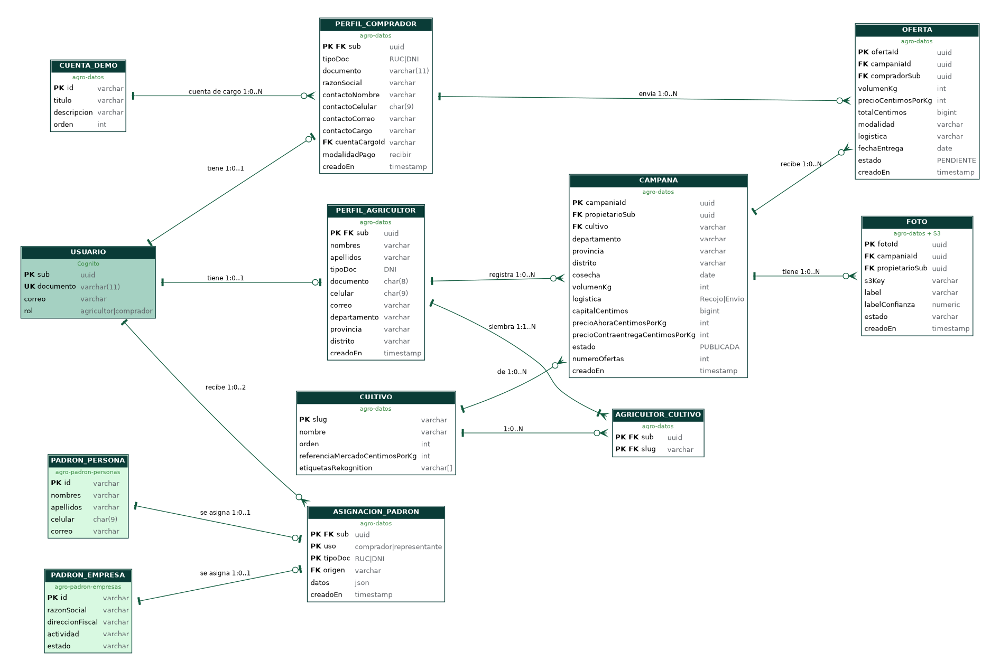
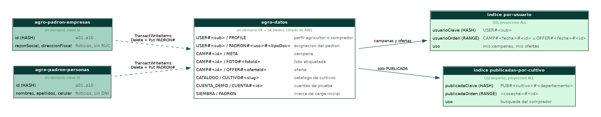

# AgroCredit - diseno de base de datos

Modelo entidad relacion, modelo real en Amazon DynamoDB y consultas por tabla. Datos ficticios (Ley 29733).
Generado por `docs/base-datos/generar.py` (decisiones 18, 58 y 64). Detalle de atributos y ejemplos JSON: `docs/modelo-datos.md`.

## 1. Antes de consultar: insertar datos y obtener los sub

Las tablas arrancan solo con el catalogo, las cuentas de prueba y el padron. Para que las consultas devuelvan algo:

1. **Insertar un agricultor y un comprador**: crear la cuenta y el perfil de cada uno en la web (registro y alta) o con Thunder Client (`docs/api/thunder/`: peticion 03 *Crear mi perfil (agricultor)* y 14 *Crear mi perfil (comprador)*).
2. Para las consultas de campanas y ofertas: registrar una campana (peticion 06) y enviar una oferta (peticion 17), o hacerlo desde la web.
3. **Obtener el `sub` de cada usuario** (identificador de Cognito con el que se arman las claves `USER#<sub>`):

PartiQL (consola de DynamoDB > Editor de PartiQL):

```sql
SELECT "sub", "rol", "documento", "PK" FROM "agro-datos" WHERE "SK" = 'PROFILE';
```

AWS CLI (desde `Conexion`: `source ./conectar.sh` y `source .venv/bin/activate`; en Windows `. .\conectar.ps1` y `.venv\Scripts\Activate.ps1`, y cambiar el `\` de fin de linea por `` ` ``). `sub` es palabra reservada de DynamoDB: va con el alias `#s`.

```bash
aws dynamodb scan --region us-east-1 --table-name agro-datos \
  --filter-expression "SK = :p" --expression-attribute-values '{":p":{"S":"PROFILE"}}' \
  --projection-expression "#s, rol, documento, PK" --expression-attribute-names '{"#s":"sub"}' --output table
```

Si la cuenta existe pero aun no tiene perfil, no aparece en DynamoDB: su `sub` esta en Cognito (consola: Cognito > Grupos de usuarios > agro-usuarios > Usuarios). Por CLI, con el `userPoolId` que devuelve `GET /api/v1/config`:

```bash
aws cognito-idp list-users --region us-east-1 --user-pool-id <userPoolId> \
  --query "Users[].{documento:Username,sub:Attributes[?Name=='sub']|[0].Value,rol:Attributes[?Name=='custom:rol']|[0].Value}" \
  --output table
```

Con el `sub` se reemplaza `<sub>` en las consultas de la seccion 6. El `<campaniaId>` sale de la respuesta 202 de *Registrar campana* (`recursoId`) o de la columna `PK` de las consultas de campanas (sin el prefijo `CAMP#`). La consulta del `sub` es un scan con filtro: valido para la demo, no para produccion.

## 2. Por que DynamoDB y no una base relacional

Se eligio **Amazon DynamoDB on-demand** (decision 3). Comparacion con una base relacional (Amazon RDS PostgreSQL o Aurora):

| Criterio | DynamoDB (elegido) | Relacional (RDS / Aurora) |
|---|---|---|
| Costo con poco uso | Pago por peticion (on-demand); a 1000 usuarios ~USD 0.15 a 0.5 al mes (docs/costos) | Instancia encendida 24x7: db.t4g.micro ~USD 12/mes + disco; Aurora Serverless v2 cobra por ACU (precios de lista aproximados, verificar) |
| Red | Endpoint regional por HTTPS; las Lambdas no necesitan estar en la VPC | Vive en la VPC: subredes privadas, grupos de seguridad y las Lambdas dentro de la VPC (sin NAT el diseno se complica) |
| Operacion | Sin servidor, sin parches, sin conexiones que administrar | Parches, versiones, tamano de instancia, pool de conexiones (RDS Proxy) |
| Escalado | Automatico por particion | Vertical o replicas de lectura |
| Transacciones | TransactWriteItems hasta 100 items (oferta + contador, padron entre tablas) | ACID completo con SQL |
| Consultas | Solo por clave e indices disenados para patrones de acceso conocidos (AP1-AP12) | SQL ad hoc, JOIN, agregaciones, reportes |
| Integridad | Sin claves foraneas: la API y las condiciones de escritura la garantizan | FOREIGN KEY, CHECK, UNIQUE en la base |
| Learner Lab | Cabe en USD 50 y se crea y destruye en segundos con Terraform | Mas lento de crear y destruir; costo fijo aunque no se use |

**Lo que se pierde**: SQL ad hoc, JOIN y claves foraneas. Se compensa con patrones de acceso disenados antes (AP1-AP12), escrituras condicionales (idempotencia), transacciones y copias controladas de datos. Para reportes, en produccion se exportaria a S3 y se consultaria con Athena.

## 3. Modelo entidad relacion (vista relacional equivalente)

Asi se veria el mismo negocio en una base relacional normalizada. Es la vista conceptual: **no se despliega**. Celeste = vive en Cognito; menta = tablas de padron; blanco = items de `agro-datos`.



DDL equivalente (PostgreSQL, solo explicativo):

```sql
-- equivalente relacional (PostgreSQL) solo para explicar el modelo; NO se despliega
CREATE TABLE usuario (            -- vive en Amazon Cognito, no en la base
  sub uuid PRIMARY KEY, documento varchar(11) UNIQUE NOT NULL, correo varchar NOT NULL,
  rol varchar(10) NOT NULL CHECK (rol IN ('agricultor','comprador')));
CREATE TABLE cultivo (slug varchar PRIMARY KEY, nombre varchar NOT NULL, orden int,
  referencia_mercado_centimos_por_kg int NOT NULL, etiquetas_rekognition varchar[]);
CREATE TABLE cuenta_demo (id varchar PRIMARY KEY, titulo varchar, descripcion varchar, orden int);
CREATE TABLE perfil_agricultor (sub uuid PRIMARY KEY REFERENCES usuario, nombres varchar NOT NULL,
  apellidos varchar NOT NULL, tipo_doc char(3) DEFAULT 'DNI', documento char(8) NOT NULL, celular char(9) NOT NULL,
  correo varchar, departamento varchar NOT NULL, provincia varchar NOT NULL, distrito varchar NOT NULL,
  creado_en timestamptz NOT NULL);
CREATE TABLE agricultor_cultivo (sub uuid REFERENCES perfil_agricultor, slug varchar REFERENCES cultivo,
  PRIMARY KEY (sub, slug));
CREATE TABLE perfil_comprador (sub uuid PRIMARY KEY REFERENCES usuario, tipo_doc varchar(3) NOT NULL,
  documento varchar(11) NOT NULL, razon_social varchar NOT NULL, contacto_nombre varchar NOT NULL,
  contacto_celular char(9) NOT NULL, contacto_correo varchar, contacto_cargo varchar,
  cuenta_cargo_id varchar REFERENCES cuenta_demo, modalidad_pago varchar, creado_en timestamptz NOT NULL);
CREATE TABLE campana (campania_id uuid PRIMARY KEY, propietario_sub uuid NOT NULL REFERENCES perfil_agricultor,
  cultivo varchar NOT NULL REFERENCES cultivo, departamento varchar, provincia varchar, distrito varchar,
  cosecha date NOT NULL, volumen_kg int NOT NULL CHECK (volumen_kg > 0), logistica varchar,
  capital_centimos bigint, precio_ahora_centimos_por_kg int, precio_contraentrega_centimos_por_kg int,
  estado varchar NOT NULL, numero_ofertas int DEFAULT 0, creado_en timestamptz NOT NULL);
CREATE INDEX campana_publicadas ON campana (cultivo, departamento, cosecha) WHERE estado = 'PUBLICADA';
CREATE TABLE foto (foto_id uuid PRIMARY KEY, campania_id uuid NOT NULL, propietario_sub uuid NOT NULL,
  s3_key varchar, label varchar, label_confianza numeric, estado varchar, creado_en timestamptz);
CREATE TABLE oferta (oferta_id uuid PRIMARY KEY, campania_id uuid NOT NULL REFERENCES campana,
  comprador_sub uuid NOT NULL REFERENCES perfil_comprador, volumen_kg int NOT NULL, precio_centimos_por_kg int NOT NULL,
  total_centimos bigint NOT NULL, modalidad varchar, logistica varchar, fecha_entrega date, estado varchar,
  creado_en timestamptz NOT NULL);
CREATE INDEX oferta_por_comprador ON oferta (comprador_sub, creado_en DESC);
CREATE TABLE padron_empresa (id varchar PRIMARY KEY, razon_social varchar, direccion_fiscal varchar, actividad varchar, estado varchar);
CREATE TABLE padron_persona (id varchar PRIMARY KEY, nombres varchar, apellidos varchar, celular char(9), correo varchar);
CREATE TABLE asignacion_padron (sub uuid REFERENCES usuario, uso varchar, tipo_doc varchar, origen varchar NOT NULL,
  datos jsonb NOT NULL, creado_en timestamptz NOT NULL, PRIMARY KEY (sub, uso, tipo_doc));
```

## 4. Modelo real en DynamoDB



### Tablas desplegadas

| Tabla | Clave | Indices | Modo y cifrado | Que guarda |
|---|---|---|---|---|
| agro-datos | PK (texto) + SK (texto) | por-usuario (usuarioClave, usuarioOrden); publicadas-por-cultivo (publicadaClave, publicadaOrden), disperso | on-demand; cifrado de AWS; sin PITR | perfiles, campanas, fotos, ofertas, catalogo, cuentas de prueba, asignaciones del padron |
| agro-padron-empresas | id (texto) | - | on-demand; sin PITR | 10 empresas ficticias (simula SUNAT), sin RUC |
| agro-padron-personas | id (texto) | - | on-demand; sin PITR | 10 personas ficticias (simula RENIEC), sin DNI |

### Vista agregada de agro-datos (diseno de tabla unica)

Cada fila es un item; el tipo lo dicen el prefijo de la clave y el atributo `entidad`.

| entidad | PK | SK | usuarioClave | usuarioOrden | publicadaClave | publicadaOrden | Atributos principales |
|---|---|---|---|---|---|---|---|
| USUARIO (agricultor) | USER#a1b2...0001 | PROFILE |  |  |  |  | rol=agricultor, nombres, apellidos, documento, celular, cultivos=[papa], departamento... |
| USUARIO (comprador) | USER#a1b2...0002 | PROFILE |  |  |  |  | rol=comprador, tipoDoc=RUC, documento, razonSocial, contacto*, cuentaCargoId |
| PADRON_ASIGNADO | USER#a1b2...0002 | PADRON#comprador#RUC |  |  |  |  | origen=EMPRESA#e03, datos{razonSocial...} |
| CAMPANA | CAMP#6f1c...9e11 | META | USER#a1b2...0001 | CAMP#2026-10-06T...#6f1c... | PUB#papa#Cusco | 2027-06-15#6f1c... | cultivo, volumenKg=2000, precios en centimos, estado=PUBLICADA, numeroOfertas=1 |
| FOTO | CAMP#6f1c...9e11 | FOTO#0b7e... |  |  |  |  | s3Key=&lt;sub&gt;/papa_20261006_150000.jpg, label=papa, labelConfianza=99, estado=ETIQUETADA |
| OFERTA | CAMP#6f1c...9e11 | OFFER#9d8e... | USER#a1b2...0002 | OFFER#2026-10-06T...#9d8e... |  |  | volumenKg=1200, precioCentimosPorKg=185, totalCentimos=222000, estado=PENDIENTE |
| CULTIVO | CATALOGO | CULTIVO#papa |  |  |  |  | nombre=Papa, referenciaMercadoCentimosPorKg=120, etiquetasRekognition=[Potato] |
| CUENTA_DEMO | CUENTA_DEMO | CUENTA#cc-8830 |  |  |  |  | titulo, descripcion=Cuenta ficticia de prueba |
| MARCA | SIEMBRA | PADRON |  |  |  |  | creadoEn, tablasPadron (fecha de creacion de cada tabla) |

### De la tabla relacional al item de DynamoDB

| Relacional | DynamoDB | Por que |
|---|---|---|
| usuario | Amazon Cognito (username = DNI o RUC, atributo custom:rol) | La identidad no se guarda en la base; el sub enlaza todo. |
| perfil_agricultor, perfil_comprador | agro-datos: PK=USER#&lt;sub&gt;, SK=PROFILE | Un solo item por usuario; el atributo rol distingue el subtipo. |
| agricultor_cultivo (N:M) | atributo lista cultivos en el PROFILE | La tabla intermedia desaparece: la lista se lee con el perfil. |
| campana | agro-datos: PK=CAMP#&lt;id&gt;, SK=META | La FK propietario_sub pasa a la clave del indice por-usuario. |
| foto, oferta (1:N de campana) | mismo PK CAMP#&lt;id&gt; con SK FOTO#... y OFFER#... | Coleccion de items: una sola Query trae la campana y lo que cuelga de ella (sin JOIN). |
| indice oferta_por_comprador | indice global por-usuario (usuarioClave=USER#&lt;sub&gt;) | El mismo indice sirve para mis campanas y mis ofertas. |
| indice parcial campana_publicadas | indice global disperso publicadas-por-cultivo | Solo las campanas publicadas llevan publicadaClave: el indice no guarda las demas. |
| JOIN oferta - campana - perfil | copias en la oferta: cultivo, productorNombre, departamento, compradorNombre | Desnormalizacion controlada: se copia al crear, nunca se actualiza. |
| numero de ofertas (COUNT) | atributo numeroOfertas en META | Lo incrementa el worker en la misma transaccion que crea la oferta. |
| cultivo, cuenta_demo | agro-datos: PK=CATALOGO y PK=CUENTA_DEMO | Datos de referencia pequenos; la API cachea el catalogo 60 s. |
| padron_empresa, padron_persona | tablas propias agro-padron-empresas y agro-padron-personas | Simulan SUNAT y RENIEC; el registro se borra al asignarse. |
| asignacion_padron | agro-datos: PK=USER#&lt;sub&gt;, SK=PADRON#&lt;uso&gt;#&lt;tipoDoc&gt; | Se crea en la misma transaccion que borra el registro del padron. |

### Patrones de acceso

| # | Patron | Operacion | Tabla o indice | Clave |
|---|---|---|---|---|
| AP1 | Perfil del usuario | GetItem | agro-datos | USER#&lt;sub&gt; / PROFILE |
| AP2 | Campana por id | GetItem | agro-datos | CAMP#&lt;id&gt; / META |
| AP3 | Mis campanas | Query | agro-datos . por-usuario | usuarioClave=USER#&lt;sub&gt;, usuarioOrden empieza con CAMP# |
| AP4 | Mis ofertas | Query | agro-datos . por-usuario | usuarioClave=USER#&lt;sub&gt;, usuarioOrden empieza con OFFER# |
| AP5 | Ofertas de una campana | Query | agro-datos | PK=CAMP#&lt;id&gt;, SK empieza con OFFER# |
| AP6 | Fotos de una campana | Query | agro-datos | PK=CAMP#&lt;id&gt;, SK empieza con FOTO# |
| AP7 | Publicadas por cultivo y zona | Query | agro-datos . publicadas-por-cultivo | publicadaClave=PUB#&lt;cultivo&gt;#&lt;departamento&gt; |
| AP8 | Crear perfil, campana, oferta, foto | PutItem condicional | agro-datos | attribute_not_exists(PK) |
| AP9 | Catalogo de cultivos | Query | agro-datos | PK=CATALOGO |
| AP10 | Tomar un registro del padron | Scan + TransactWriteItems | agro-padron-* + agro-datos | Delete en padron + Put PADRON#... |
| AP11 | Asignacion de padron del usuario | GetItem | agro-datos | USER#&lt;sub&gt; / PADRON#&lt;uso&gt;#&lt;tipoDoc&gt; |
| AP12 | Cuentas de prueba | Query | agro-datos | PK=CUENTA_DEMO |

## 5. Cada microservicio y sus datos

La API (FastAPI en ECS Fargate) se organiza en cuatro dominios, mas dos Lambdas. Cada dominio es dueno de sus items (prefijo de clave) y solo el padron tiene tablas fisicas propias. Ningun dominio escribe los items de otro, salvo el contador `numeroOfertas`, que el worker actualiza en la misma transaccion que crea la oferta.

| Microservicio | Datos de los que es dueno | Servicios que usa |
|---|---|---|
| Identidad y perfil | agro-datos: items USER#&lt;sub&gt; / PROFILE | Cognito (identidad) |
| Campanas y fotos | agro-datos: items CAMP#&lt;id&gt; / META y FOTO#; S3 agro-fotos | SQS agro-insercion, Lambdas agro-worker y agro-etiquetar |
| Ofertas | agro-datos: items CAMP#&lt;id&gt; / OFFER#; contador numeroOfertas | SQS agro-insercion, Lambda agro-worker |
| Padron y catalogos | tablas agro-padron-empresas y agro-padron-personas; agro-datos: CATALOGO, CUENTA_DEMO, PADRON# | - |

**Limitacion conocida**: los dominios comparten la tabla `agro-datos` (diseno de tabla unica). Separarlos en una tabla por servicio es posible, pero la transaccion oferta + contador cruzaria tablas y se perderia la Query unica de una campana con sus fotos y ofertas.

### Que tabla o servicio toca cada API

| API o funcion | Microservicio | Tipo | Tabla o servicio | Operacion |
|---|---|---|---|---|
| GET /salud | Plataforma | lectura | memoria de la tarea ECS (sin tabla) | - |
| GET /config | Identidad y perfil | lectura | variables de entorno de la tarea: ids de Cognito (sin tabla) | - |
| POST /perfil | Identidad y perfil | escritura directa | agro-datos | PutItem USER#&lt;sub&gt; / PROFILE (condicion attribute_not_exists); lee CATALOGO o CUENTA_DEMO para validar |
| GET /perfil | Identidad y perfil | lectura | agro-datos | GetItem USER#&lt;sub&gt; / PROFILE |
| GET /catalogo/cultivos | Padron y catalogos | lectura | agro-datos | Query PK=CATALOGO, SK empieza con CULTIVO# |
| POST /padron/consulta | Padron y catalogos | escritura directa (transaccion) | agro-padron-empresas o agro-padron-personas + agro-datos | Scan consistente + TransactWriteItems: Delete del registro del padron + Put USER#&lt;sub&gt; / PADRON#&lt;uso&gt;#&lt;tipoDoc&gt; |
| GET /cuentas-demo | Padron y catalogos | lectura | agro-datos | Query PK=CUENTA_DEMO |
| POST /campanas | Campanas y fotos | escritura asincrona | SQS agro-insercion -&gt; Lambda agro-worker -&gt; agro-datos | la api lee CATALOGO y PROFILE y encola; el worker hace PutItem CAMP#&lt;id&gt; / META con indices por-usuario y publicadas-por-cultivo |
| GET /campanas/{campaniaId} | Campanas y fotos | lectura | agro-datos | GetItem CAMP#&lt;id&gt; / META |
| PATCH /campanas/{campaniaId} | Campanas y fotos | actualizacion directa | agro-datos | UpdateItem CAMP#&lt;id&gt; / META con condicion attribute_exists(PK) AND propietarioSub = &lt;sub&gt; AND numeroOfertas = 0 |
| GET /campanas | Campanas y fotos | lectura | agro-datos (indice por-usuario) | Query usuarioClave=USER#&lt;sub&gt;, usuarioOrden empieza con CAMP# |
| POST /campanas/{campaniaId}/fotos/url | Campanas y fotos | escritura asincrona | S3 agro-fotos -&gt; SQS agro-fotos -&gt; Lambda agro-etiquetar -&gt; Rekognition -&gt; agro-datos | la api firma un POST a entrada/&lt;sub&gt;/&lt;campana&gt;/&lt;foto&gt;; la lambda registra CAMP#&lt;id&gt; / FOTO#&lt;fotoId&gt; |
| GET /campanas/{campaniaId}/fotos | Campanas y fotos | lectura | agro-datos + S3 agro-fotos | Query PK=CAMP#&lt;id&gt;, SK empieza con FOTO#; URL de lectura temporal |
| GET /campanas/publicadas | Campanas y fotos | lectura | agro-datos (indice publicadas-por-cultivo) | Query publicadaClave=PUB#&lt;cultivo&gt;#&lt;departamento&gt; |
| POST /campanas/{campaniaId}/ofertas | Ofertas | escritura asincrona | SQS agro-insercion -&gt; Lambda agro-worker -&gt; agro-datos | la api lee META y PROFILE y encola; el worker hace TransactWriteItems: Put CAMP#&lt;id&gt; / OFFER#&lt;id&gt; + Update META numeroOfertas |
| GET /ofertas | Ofertas | lectura | agro-datos (indice por-usuario) | Query usuarioClave=USER#&lt;sub&gt;, usuarioOrden empieza con OFFER# |
| GET /campanas/{campaniaId}/ofertas | Ofertas | lectura | agro-datos | Query PK=CAMP#&lt;id&gt;, SK empieza con OFFER# |
| Lambda agro-worker | Escrituras asincronas (campanas y ofertas) | escritura asincrona | SQS agro-insercion -&gt; agro-datos | PutItem CAMP#/META condicional; oferta: TransactWriteItems Put OFFER# + Update numeroOfertas |
| Lambda agro-etiquetar | Fotos | escritura asincrona | S3 agro-fotos -&gt; SQS agro-fotos -&gt; Rekognition -&gt; agro-datos | copia la foto a &lt;sub&gt;/&lt;slug&gt;_&lt;fecha&gt;.&lt;ext&gt;, PutItem CAMP#/FOTO#, borra el original |

Coleccion para probarlas en orden (Thunder Client o Postman): `docs/api/thunder/LEEME.md`.

## 6. Consultas por tabla (solo lectura)

Reemplazar `<sub>` y `<campaniaId>` con lo obtenido en la seccion 1.

### Todo lo de una campana (evidencia del insert de campana y de la oferta) (`agro-datos`)

PartiQL:

```sql
SELECT * FROM "agro-datos" WHERE "PK" = 'CAMP#<campaniaId>';
```

AWS CLI:

```bash
aws dynamodb query --region us-east-1 --table-name agro-datos \
  --key-condition-expression "PK = :pk" \
  --expression-attribute-values '{":pk":{"S":"CAMP#<campaniaId>"}}'
```

### Perfil de un usuario (AP1) (`agro-datos`)

PartiQL:

```sql
SELECT * FROM "agro-datos" WHERE "PK" = 'USER#<sub>' AND "SK" = 'PROFILE';
```

AWS CLI:

```bash
aws dynamodb get-item --region us-east-1 --table-name agro-datos \
  --key '{"PK":{"S":"USER#<sub>"},"SK":{"S":"PROFILE"}}'
```

### Ofertas de una campana (AP5) (`agro-datos`)

PartiQL:

```sql
SELECT * FROM "agro-datos" WHERE "PK" = 'CAMP#<campaniaId>' AND begins_with("SK", 'OFFER#');
```

AWS CLI:

```bash
aws dynamodb query --region us-east-1 --table-name agro-datos \
  --key-condition-expression "PK = :pk AND begins_with(SK, :o)" \
  --expression-attribute-values '{":pk":{"S":"CAMP#<campaniaId>"},":o":{"S":"OFFER#"}}'
```

### Catalogo de cultivos (AP9) y cuentas de prueba (AP12) (`agro-datos`)

PartiQL:

```sql
SELECT * FROM "agro-datos" WHERE "PK" = 'CATALOGO';
SELECT * FROM "agro-datos" WHERE "PK" = 'CUENTA_DEMO';
```

AWS CLI:

```bash
aws dynamodb query --region us-east-1 --table-name agro-datos \
  --key-condition-expression "PK = :pk" --expression-attribute-values '{":pk":{"S":"CATALOGO"}}'
```

### Ultimas campanas creadas (solo demo: es un scan con filtro) (`agro-datos`)

PartiQL:

```sql
SELECT "PK", "cultivo", "departamento", "volumenKg", "numeroOfertas", "creadoEn"
FROM "agro-datos" WHERE "entidad" = 'CAMPANA';
```

AWS CLI:

```bash
aws dynamodb scan --region us-east-1 --table-name agro-datos \
  --filter-expression "entidad = :e" --expression-attribute-values '{":e":{"S":"CAMPANA"}}' \
  --projection-expression "PK, cultivo, departamento, volumenKg, numeroOfertas, creadoEn"
```

### Mis campanas (AP3) (`agro-datos . por-usuario`)

PartiQL:

```sql
SELECT * FROM "agro-datos"."por-usuario"
WHERE "usuarioClave" = 'USER#<sub>' AND begins_with("usuarioOrden", 'CAMP#');
```

AWS CLI:

```bash
aws dynamodb query --region us-east-1 --table-name agro-datos --index-name por-usuario \
  --key-condition-expression "usuarioClave = :u AND begins_with(usuarioOrden, :p)" \
  --expression-attribute-values '{":u":{"S":"USER#<sub>"},":p":{"S":"CAMP#"}}'
```

### Mis ofertas (AP4) (`agro-datos . por-usuario`)

PartiQL:

```sql
SELECT * FROM "agro-datos"."por-usuario"
WHERE "usuarioClave" = 'USER#<sub>' AND begins_with("usuarioOrden", 'OFFER#');
```

AWS CLI:

```bash
aws dynamodb query --region us-east-1 --table-name agro-datos --index-name por-usuario \
  --key-condition-expression "usuarioClave = :u AND begins_with(usuarioOrden, :p)" \
  --expression-attribute-values '{":u":{"S":"USER#<sub>"},":p":{"S":"OFFER#"}}' --no-scan-index-forward
```

### Campanas publicadas de papa en Cusco (AP7) (`agro-datos . publicadas-por-cultivo`)

PartiQL:

```sql
SELECT "PK", "productorNombre", "cosecha", "volumenKg", "numeroOfertas"
FROM "agro-datos"."publicadas-por-cultivo" WHERE "publicadaClave" = 'PUB#papa#Cusco';
```

AWS CLI:

```bash
aws dynamodb query --region us-east-1 --table-name agro-datos --index-name publicadas-por-cultivo \
  --key-condition-expression "publicadaClave = :c" \
  --expression-attribute-values '{":c":{"S":"PUB#papa#Cusco"}}'
```

### Empresas que quedan en el padron (`agro-padron-empresas`)

PartiQL:

```sql
SELECT "id", "razonSocial", "actividad" FROM "agro-padron-empresas";
```

AWS CLI:

```bash
aws dynamodb scan --region us-east-1 --table-name agro-padron-empresas --consistent-read \
  --projection-expression "id, razonSocial" --output table
```

### Personas que quedan en el padron (`agro-padron-personas`)

PartiQL:

```sql
SELECT "id", "nombres", "apellidos" FROM "agro-padron-personas";
```

AWS CLI:

```bash
aws dynamodb scan --region us-east-1 --table-name agro-padron-personas --consistent-read \
  --projection-expression "id, nombres, apellidos" --output table
```

### Asignaciones del padron hechas (solo demo: scan con filtro) (`agro-datos`)

PartiQL:

```sql
SELECT "PK", "SK", "origen", "creadoEn" FROM "agro-datos" WHERE "entidad" = 'PADRON_ASIGNADO';
```

AWS CLI:

```bash
aws dynamodb scan --region us-east-1 --table-name agro-datos \
  --filter-expression "entidad = :e" --expression-attribute-values '{":e":{"S":"PADRON_ASIGNADO"}}'
```

Un SELECT de PartiQL sin condicion sobre la clave de particion es un **scan** completo: en la demo es irrelevante, en produccion se evita. No usar INSERT, UPDATE ni DELETE de PartiQL sobre estas tablas: romperia la idempotencia y el contador que mantiene el worker.
