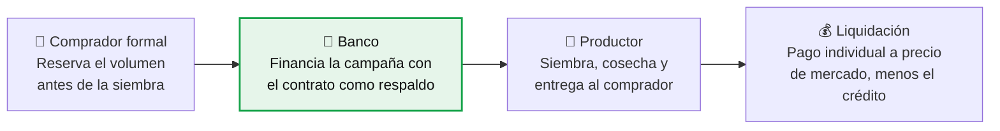
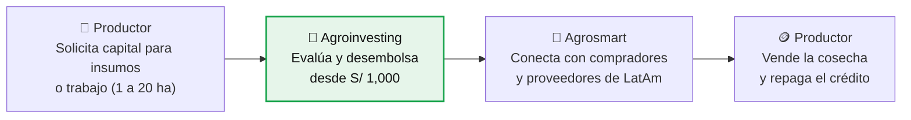
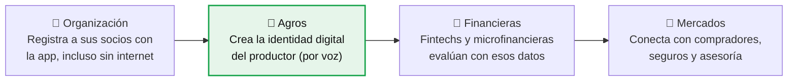
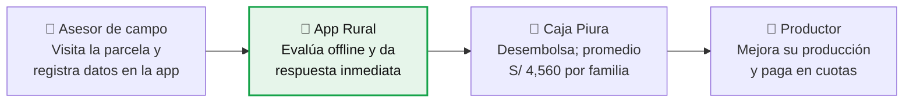
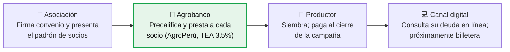
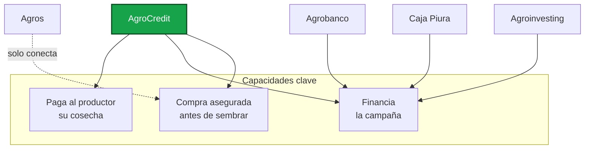

# Benchmark — AgroCredit

> **Proyecto Parcial · Parte A: Análisis (QUÉ)**
> Curso: Cloud Computing · Maestría en Ciencia de Datos e Inteligencia Artificial (UTEC Posgrado)
> Producto: **AgroCredit — Crédito de campaña con venta asegurada**

---

## Índice

1. [Nuestro producto](#1-nuestro-producto-crédito-de-campaña-con-venta-asegurada)
2. [Competidores nacionales](#2-cuatro-competidores-en-perú)
3. [Fichas por competidor](#3-fichas-por-competidor)
   - [Agroinvesting](#31-agroinvesting-microcrédito-agrícola-desde-s-1000)
   - [Agros](#32-agros-identidad-digital-para-llegar-al-crédito)
   - [Caja Piura](#33-caja-piura-el-asesor-aprueba-el-crédito-en-campo)
   - [Agrobanco](#34-agrobanco-crédito-estatal-vía-asociaciones-rumbo-a-lo-digital)
4. [Cuadro comparativo](#4-cuadro-comparativo)
5. [Conclusión: la oportunidad](#5-conclusión-la-oportunidad)

---

## 1. Nuestro producto: crédito de campaña con venta asegurada

*El banco financia la siembra y liquida a cada productor al precio de mercado del día de entrega.*

### Flujo

### Tipo de clientes
- Pequeños productores, individuales o asociados
- Compradores formales: agroindustria, exportadores, molinos

### Funcionalidades
- Contrato de compra previo a la siembra
- Crédito de campaña respaldado por el contrato
- Liquidación individual automática a la entrega

### Propuesta de valor
- **Productor:** venta segura, crédito formal e historial
- **Comprador:** abastecimiento sin financiar a nadie
- **Banco:** repago directo desde la venta

---

## 2. Cuatro competidores en Perú

*Una fintech, una agtech, una caja municipal y el banco agropecuario del Estado.*

| Competidor | Tipo | Qué hace |
|---|---|---|
| **Agroinvesting** | Fintech | Crédito de capital de trabajo desde S/ 1,000 |
| **Agros** | Agtech (Piura) | Identidad digital que conecta al productor con crédito y mercados |
| **Caja Piura** | Caja municipal | App Rural: el asesor evalúa y aprueba en campo |
| **Agrobanco** | Banca estatal | Crédito vía asociaciones a TEA 3.5% (AgroPerú) |

---

## 3. Fichas por competidor

### 3.1 Agroinvesting: microcrédito agrícola desde S/ 1,000

*Fintech peruana activa desde 2019, enfocada en capital de trabajo para el pequeño productor.*

**Tipo de clientes**
- Agricultores de 1 a 20 ha (papa, arroz, camote)
- Trabajadores rurales no bancarizados
- Medianas empresas agrícolas

**Funcionalidades**
- Crédito de capital de trabajo e insumos
- Financiamiento de riego, invernaderos y maquinaria
- Marketplace Agrosmart

**Propuesta de valor**
- Acceso a crédito sin historial bancario
- Montos pequeños adaptados a la campaña
- Más de 11 mil agricultores financiados

> **Fuente:** Gestión, entrevista a Alberto Falcón, CEO de Agroinvesting.

---

### 3.2 Agros: identidad digital para llegar al crédito

*Agtech piurana que digitaliza organizaciones de productores y las conecta con financieras y compradores.*

**Tipo de clientes**
- Agricultores familiares
- Organizaciones de productores
- Aliados: fintechs, microfinancieras y entidades públicas

**Funcionalidades**
- Identidad digital accesible por llamada
- App de campo offline y panel web
- Seguros con imágenes satelitales
- Teleasesoría técnica

**Propuesta de valor**
- Historial digital para acceder a crédito
- Acceso a mercados y servicios en un solo lugar
- 10 mil a 20 mil productores conectados

> **Fuente:** Descubre.vc; GFAR/INCLUDAS (2022); Agraria.pe (2023).

---

### 3.3 Caja Piura: el asesor aprueba el crédito en campo

*App Rural, premiada por Indecopi en 2022, funciona con y sin internet.*

**Tipo de clientes**
- Familias agricultoras rurales de 20 a 74 años
- 27% mujeres
- San Martín, Amazonas, La Libertad, Cajamarca, Áncash, Lima

**Funcionalidades**
- App para asesores, opera sin conexión
- Recolección digital de datos del cliente
- Aprobación inmediata en campo

**Propuesta de valor**
- Crédito sin ir a la agencia
- Inclusión financiera en zonas alejadas
- 392 créditos por S/ 1.81 millones en un año

> **Fuente:** DPL News / Perú21 sobre App Rural de Caja Piura.

---

### 3.4 Agrobanco: crédito estatal vía asociaciones, rumbo a lo digital

*Principal financiador del pequeño productor; prevé billetera digital y autoaprobación hacia fin de 2026.*

**Tipo de clientes**
- Pequeños productores agrícolas y pecuarios
- Individuales y organizados en asociaciones o cooperativas
- 55% accede a su primer crédito

**Funcionalidades**
- Crédito de campaña y pecuario
- Banca por internet para ver deuda
- En desarrollo: billetera digital y autoaprobación
- Más de 120 puntos de atención

**Propuesta de valor**
- La tasa más baja del mercado (3.5% AgroPerú)
- Cuotas alineadas al fin de campaña
- 2025: 127 mil créditos por S/ 1,443 millones

> **Fuente:** Agraria.pe (abr 2026); Andina (sep 2026); DPL News.

---

## 4. Cuadro comparativo

**Ningún competidor nacional asegura la compra antes de financiar.**

| Criterio | Agroinvesting | Agros | Caja Piura | Agrobanco | **Nuestro producto** |
|---|---|---|---|---|---|
| **Tipo de clientes** | Productores de 1 a 20 ha y trabajadores rurales | Agricultores familiares y sus organizaciones | Familias rurales | Pequeños productores y asociaciones | **Pequeños productores y compradores formales** |
| **Canal digital** | Plataforma fintech | App offline, panel web, llamada | App offline del asesor | Consulta web; billetera en camino | **Digital para solicitud y liquidación** |
| **Compra asegurada antes de sembrar** | ❌ No | ❌ No (conecta compradores) | ❌ No | ❌ No | ✅ **Sí** |
| **Financia la campaña** | ✅ Sí, montos pequeños | ❌ No, deriva a financieras | ✅ Sí | ✅ Sí, TEA 3.5% | ✅ **Sí, respaldada por el contrato** |
| **Pago al productor por su cosecha** | No aplica | No aplica | No aplica | No aplica | ✅ **Individual, a precio de mercado** |
| **Propuesta de valor** | Inclusión con montos pequeños | Datos e identidad para acceder a servicios | Cercanía y aprobación en campo | La tasa más baja | **Venta segura + crédito + pago directo** |

> **Fuente:** elaboración propia con base en las fuentes de cada ficha.

### Vista rápida de cobertura

*Lectura: los competidores cubren solo el financiamiento (o solo conectan); AgroCredit es el único que cubre las tres capacidades.*

---

## 5. Conclusión: la oportunidad

### El contrato de compra como garantía

| # | Hallazgo | Implicancia |
|---|---|---|
| 1 | **Lo digital está en la evaluación, no en la venta** | Caja Piura y Agros digitalizan la originación; nadie conecta el crédito con el comprador. |
| 2 | **La tasa la marca el Estado** | Agrobanco presta a 3.5%: competir por certeza de venta, no por precio. |
| 3 | **Espacio libre en Perú** | Ningún competidor nacional une compra asegurada, crédito y pago individual. |
